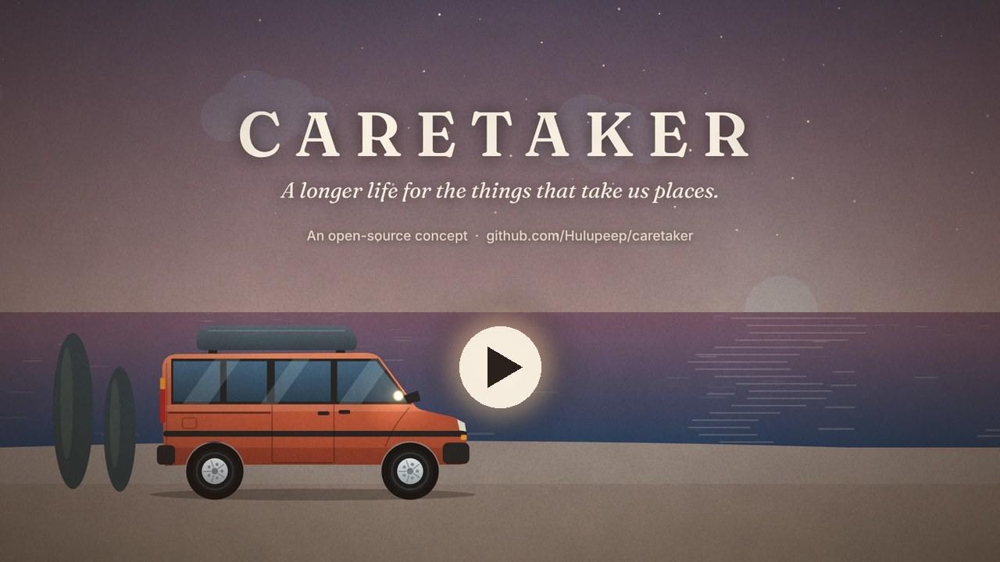

# Caretaker

**Keep the machines you love alive.**

**[Watch the 93-second concept film on YouTube](https://youtu.be/tzicF85v1a4)** · [download the MP4](media/caretaker-concept-film.mp4) · [subtitles](media/caretaker-concept-film.srt) · [script and notes](docs/concept-film.md)  
A story about one family and one old van. It illustrates the idea: nothing in it has been built or tested yet.

## Imagine never having to buy another car.

You find a van you love. You keep it for the journeys, the memories and the life built around it. When something wears out, it gets repaired. When it needs an upgrade, it gets one. Years later, it's still yours—and still taking you places.

Now imagine that same care for your grandfather's motorbike. A boat left in a field. A 1950s Kenwood mixer. A bicycle that's been through three children. A beautiful old fridge that deserves another life.

**Caretaker is an open-source experiment to make that world possible.**

We're building towards a future in which every machine can have a caretaker: a companion that gets to know it, listens to it, looks after it and helps keep it working. A team of people, software, sensors and robots that can find problems, plan repairs and bring old things back to life.

Imagine a workshop on your property. You leave a broken bicycle in the evening. Overnight, a caretaker inspects it, repairs what it can, checks its work and leaves you a report in the morning. Your old mixer, boat and van have their own histories too: what they need, what has been fixed and where their next adventure might take them.

**Fewer things thrown away. More things loved, repaired and passed on.**

This is the beginning, and we need your help to build it.

## Start with one VW T4, then a tractor, then a digger

The first user is Colm and the first vehicle use case is his planned 1996 Volkswagen T4 2.5 TDI. The actual van, ECU, sensors and measurements have not yet been verified.

Record its history; collect a dated observation; produce a brief with evidence, unknowns and the next useful check; record what a mechanic or owner finds. A simple household object can be a parallel first physical-repair case. See the [first experiment](experiments/001-t4-caretaker.md).

We're starting with a simple working observation log, machine profiles and first experiments. Bring your own machine, skills or ideas and help turn them into working systems.

## Inspiration

[MZULALI/xj-scanner](https://github.com/MZULALI/xj-scanner) connects an AI agent to a 1990s Jeep's engine computer for diagnosis. Caretaker is inspired by that work and explores a broader, longer-lived relationship between people and machines: ongoing care informed by observations, records, people, many kinds of sensors and eventually physical repair.

We have not copied its code; xj-scanner is GPL-3.0. Check third-party licences before incorporating code.

## Where we're going

1. One machine record and one real care loop.
2. Evidence-based assistance and useful sensor observations.
3. Human-led repair and verified outcomes.
4. Narrow, supervised robotic work in a guarded workshop.
5. Carefully validated, bounded overnight tasks.
6. A lifetime caretaker for many kinds of objects.

Explore the [visual timeline](docs/visual-roadmap.md) and the full [roadmap](docs/roadmap.md). Dates are illustrative hypotheses, not promises.

## Join in: bring your machine

The T4 is only the beginning. Do you have a bicycle, boat, motorbike, mixer, fridge, tractor or another machine you want to keep working? Have you built a sensor, diagnostic tool, repair system or robot—or tried an experiment that taught you something?

**Bring it here.** Share what you are working on, link an existing project, document an experiment or open a pull request. Inconclusive and failed experiments are welcome: they help everyone learn. You don't need to code or own a T4.

- [Introduce a machine or existing project](https://github.com/Hulupeep/caretaker/issues/new?template=machine.yml)
- [Propose or share an experiment](https://github.com/Hulupeep/caretaker/issues/new?template=experiment.yml)
- [Explore machine profiles](machines/README.md) and the [contribution guide](CONTRIBUTING.md)

## Start building

- [Run the first observation log](tools/README.md) on your own computer.
- Explore sensor ideas for a [1970s tractor](machines/tractors/1970s-tractor.md) and [JCB-type plant equipment](machines/plant/jcb-backhoe-concept.md).
- Propose a sensor, machine interface or data importer using the [sensor guide](docs/sensors-and-adapters.md) and [adapter contract](docs/adapter-contract.md).

These first profiles are starting hypotheses; contribute measurements and results from real machines.

## Repository

- [Concept film: script and notes](docs/concept-film.md)
- [Use cases and commercial angles](docs/use-cases-and-commercial-angles.md)
- [Product hypothesis](docs/product-hypothesis.md)
- [Roadmap and gates](docs/roadmap.md)
- [First T4 experiment](experiments/001-t4-caretaker.md)
- [Machine record template](examples/machine-record.md)
- [Contribution guide](CONTRIBUTING.md)

## Principles

Learn from real machines. Share the evidence, including what doesn't work. Give owners control of their data. Build with repairers and specialists, verify the work, and earn each new level of autonomy.

## Licence

MIT for original repository material; see LICENSE. Third-party code and data retain their own licences.
