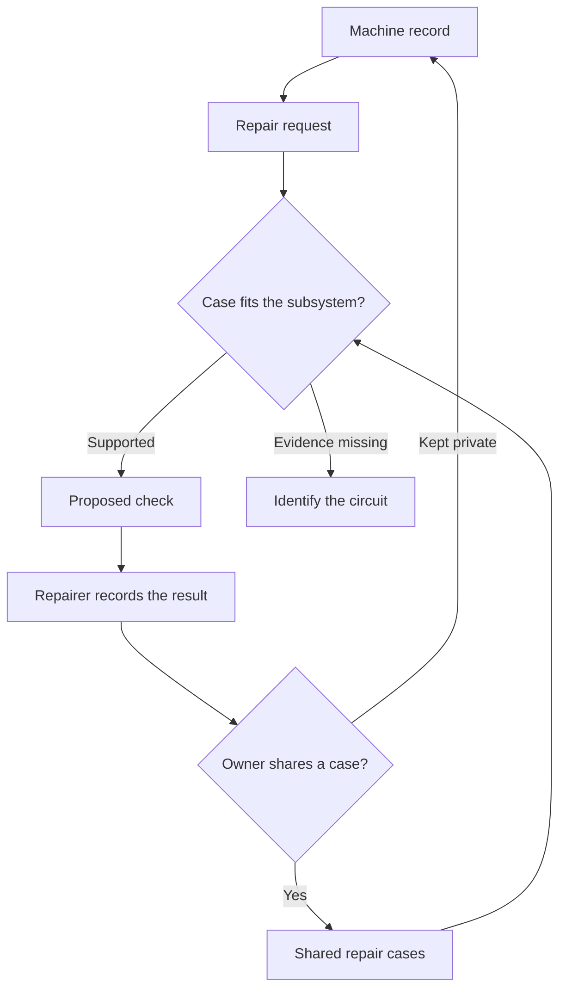

# Proposal for federated repair agents

Imagine your old van starts cranking slowly. Its Caretaker calls a starting-system specialist that can show a checked repair from a similar circuit. The specialist uses the earlier case to suggest a measurement for this van. A mechanic performs the check, finds the cause, and records whether the fix held. If the owner chooses to share an anonymised case, the next owner gets the benefit of that work.

**Hypothesis.** An owner gets a better first diagnostic check when a specialist can bring evidence from a comparable machine. Test that on one problem across two machines. The long-term platform makes those specialists callable, inspectable and runnable by anyone.

## What travels between machines

The owner's Caretaker holds the machine's service history, symptoms, sensor data and repairs. It can share an excerpt selected for a job. A specialist returns a proposed check and cites the evidence behind it. A shared repair case records what was tried, including failed attempts, and what was verified. A new owner can run the open specialist locally or ask a trusted operator to run it.

| Artifact | Minimum contents |
| --- | --- |
| Repair case | Machine family and variant, subsystem, operating conditions, symptom, observations with units and source, checks attempted, intervention if any, before-and-after result, verifier, date, and licence for shared material. A case can record an unresolved or unsuccessful attempt. |
| Specialist manifest | Name, version or commit, source and licence, supported subsystem and applicability limits, expected inputs, permitted tools, and IDs of cases the specialist can substantiate. Every past-work claim points to an outcome or test. |
| Recommendation | One discriminating check, why it could change the decision, applicable evidence with source references, which observations are missing, and what result would send the investigation down a different path. |

An open specialist is a versioned package of instructions, tools, applicability rules and tests. Its reputation comes from results that can be inspected. A person's verified repair can seed a specialist. Record it as a human repair and record the specialist's subsequent use separately. Keep a self-report, a physical observation, a result independently checked by a repairer, and a simulated fixture distinct. Two agents citing the same repair still provide one piece of evidence. The owner can export their machine record, choose who can see it, fork a specialist and run it with a model they choose.

## How a match earns its place

Match the part or circuit, configuration and conditions first. The search can use symptom wording to find candidates. Use the machine's own documentation or a physical identification for any connector, part number, threshold, test point or procedure that depends on the variant.

| Match | What the result can carry forward |
| --- | --- |
| Same relevant component or circuit with verified fit | A prior repair and its check, scoped to the supported revisions and conditions. Show the fit evidence. |
| Similar subsystem on a different machine | A diagnostic idea and a check to validate locally. Label the earlier case as an analogy and list any differences that matter. |
| Unknown configuration or incompatible design | The information needed to make a match. Leave the model-specific procedure unresolved. |

For the first test, consider a 1996 T4 ACV and an older diesel tractor. If both have a comparable conventional starting circuit, a prior cable or ground fault can make a measurement under load worth trying early. The tractor can contribute a repair even if it has no ECU. An unverified voltage or earth arrangement changes applicability. Carry over the diagnostic reasoning and confirm the test points and limits on each machine with its own service information. The T4's existing logger can add context. Its ECU supply reading alone cannot establish the battery voltage or the condition of the starter circuit. [Caretaker T4 guide](../machines/vw-t4-acv/README.md) · [Fluke on voltage-drop diagnosis](https://www.fluke.com/en-us/learn/blog/automotive/electrical-automotive-troubleshooting) · [Delco Remy on cranking faults](https://www.delcoremy.com/the-latest/2023/june-2023/tech-tip-diagnosing-starter-cranking-problems)

Prefer an intermittent fault for the live pilot. For example, a prior case could show that a check looked normal cold and exposed the fault only during a hot restart. Capture the conditions that made the measurement useful. A textbook check alone is an insufficient test of the value of shared experience.

## What to give Seraphina

Ask Seraphina to propose two peers. One should build a callable starting-system specialist. The second should independently replay the case and test its applicability on another machine. Ask each peer for a concrete artifact and what they can verify. A first physical test needs a person with the machine, evidence and permission. RuFlo's docs describe Seraphina as a coordinator who reads the roster and claims and proposes assignments for an operator. [RuFlo's Seraphina and Federation guide](https://github.com/ruvnet/ruflo/blob/main/docs/ruflo-explained.md)

**First PR.** A small, local callable entry point accepts a symptom, a machine profile, a few observations and a directory of versioned case files. It returns one next check or one question, with references to the specific observations, case and documentation that justify it. Use the [existing observation fields](adapter-contract.md). Ship three labelled fixtures that cover a supported circuit match, a transferable idea with unresolved fit, and a false match where the engine cranks normally but fails to fire. Also verify that missing circuit details lead to an identification question. Give an operator one command to replay the fixtures. Tools for a hosted agent receive the selected evidence, and the owner's Caretaker retains local access to sensors and actuators.

Use GitHub for the first manifests and case files. Use RuFlo for peer discovery and work coordination when available. Once a second caller or host needs to interoperate, an A2A Agent Card can advertise the specialist and MCP can expose named local data tools. Keep the repair-case format portable across hosts. [A2A Agent Card specification](https://a2a-protocol.org/latest/specification/#8-agent-discovery-the-agent-card) · [MCP tools specification](https://modelcontextprotocol.io/specification/latest/server/tools)

## How we judge the pilot

1. Get an independent mechanic's checked case and permission to share it. Capture a second real case with the confirmed outcome withheld from the agent. If access is limited, demonstrate the software with fixtures and leave the physical claim pending.
2. Run the second case once with the machine data and applicable manual, then replay with the prior case available. Ask the mechanic to judge the usefulness of the first check before seeing which run used the prior case. Record whether it improved the sequence, avoided an unnecessary part swap, or reproduced the existing advice. Record any misleading transfer.
3. If the first comparison shows a credible improvement, invite an independent diesel or agricultural mechanic to try it on the next intermittent starting fault as a paid pilot. Expand the network after there is repeatable evidence of value. If comparable cases repeatedly add nothing to the next decision, keep the local log and evidence files and revisit the hypothesis when there is a better case.

The commercial hypothesis is paid diagnostic time saved for an independent workshop, with open case formats, reusable specialists and owner-exportable records. Start by asking a mechanic whether they will pay for a check that advances a live job.

## How the network grows

1. **Two machines, one specialist.** A repairer contributes the original case and a second repairer replays it on another machine. The result becomes a test that future versions can rerun.
2. **Several specialists, one owner.** A machine can call a wiring specialist for a difficult starting fault or a parts specialist when an original component is scarce. Contributors can send a checked repair, add a machine profile, provide a sensor adapter, or maintain a specialist. Publish a directory when there are specialists worth choosing among. Surface failed applications alongside successful ones.
3. **A workshop with hands.** The same case records can specify how a person checked a repair and what evidence confirmed it. Later, Caretaker can use those records to select a bounded task for a fixture or robot. The local workshop owns execution and records a new verification result for each job.

## Work to build on

- Open Repair Alliance already collects outcomes and repair barriers. Use its standard for compatible exports where it fits and add the observations and verification needed to reuse a specific check. [Open Repair Data Standard](https://openrepair.org/open-data/open-standard/)
- Identifix shows an established workflow around searching technician-confirmed vehicle fixes. iFixit FixBot brings manuals and guides into conversational diagnosis, and Repair Relay describes a shared workbench where a person confirms physical observations. Caretaker's experiment is whether an open specialist can reuse and explain a verified check across machines. [Identifix Direct-Hit](https://www.identifix.com/direct-hit/) · [iFixit FixBot](https://www.ifixit.com/News/114700/introducing-fixbot) · [Repair Relay](https://devpost.com/software/repair-relay)
- Farm Hack's Tool Library lets growers share designs for equipment. Invite contributors to add what they measured, what they changed and whether it worked on the machine they actually used. Link to third-party manuals and guides and respect the applicable licence for any material we redistribute. [Farm Hack](https://www.farmhack.org/content/get-started)
