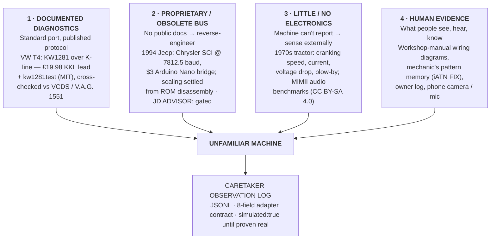
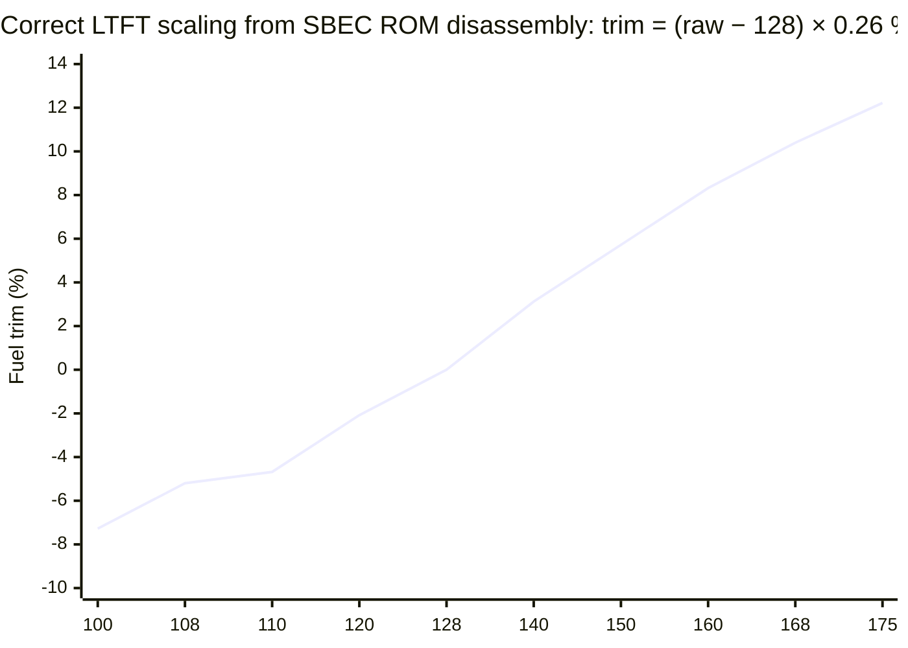

# Giving an Unfamiliar Machine a Working Caretaker

**A deep-research report on machine-side care agents — what people have already built, what we can borrow, how agents should collaborate, and the smallest thing worth building first.**
*13 November 2026*

---

## Decision brief (one page)

**The question.** How do you give an unfamiliar machine a working "Caretaker" — a persistent agent that observes it, reasons honestly about it, and helps a human keep it alive — and how do you grow that into an open-source, right-to-repair-friendly platform?

**The verdict.** The best starting point already exists and it is not a vehicle project: it is the **First PR specified inside the federated-repair-agents proposal itself** — a small, local, callable entry point that accepts a symptom, a machine profile, a handful of observations and a directory of versioned repair-case files, and returns **one next check or one question**, shipped with three labelled fixtures and one replay command ([Caretaker PR #6](https://github.com/Hulupeep/caretaker/pull/6)). It requires no vehicle hardware, runs offline, is machine-verifiable, and directly tests the federation hypothesis — that a *prior verified case* measurably improves the first check an agent recommends. Build that first; then put it next to a real machine.

**First physical machine.** Colm's planned **1996 VW T4 2.5 TDI (ACV)** — chosen by the Caretaker repo itself, and correct on the merits: documented diagnostics (KW1281 over K-line), a **£19.98 KKL lead**, a mature **MIT-licensed** open tool ([kw1281test](https://github.com/gmenounos/kw1281test)) to cross-check against, a workshop manual, and a written first-experiment protocol with acceptance criteria that demand traceable claims and forbid invented evidence ([Caretaker experiment 001](https://github.com/Hulupeep/caretaker/blob/main/experiments/001-t4-caretaker.md)). First job: **read-only identification and logging** — identify the ECU, read fault codes, log measuring blocks — with every value cross-checked against VCDS or a V.A.G. 1551 before the agent is allowed to call it real.

**What the Jeep project proves.** Muhammad Zulali's [xj-scanner](https://github.com/MZULALI/xj-scanner) shows that a **$3 Arduino Nano, three wires, and a coding agent** can open a 32-year-old proprietary bus that no commercial scan tool reads, and that the same setup can pass a real California smog test after repeated failures ([Yahoo Autos](https://autos.yahoo.com/classic-and-collector/articles/claude-ai-started-controlling-engine-221031427.html)). It also contains the single most instructive artefact in this whole report: a **documented wrong first diagnosis** — a fuel-trim scaling error that reported −4.7 % as "+21.6 %" and sent a day of testing after a fault that did not exist, corrected only by disassembling the ECU's own ROM ([xj-scanner parameters](https://github.com/MZULALI/xj-scanner/blob/main/docs/parameters.md)). That case, not the smog pass, is the design lesson.

**What to borrow.** Borrow xj-scanner's **pattern** (AGENTS.md behavioural contract, skill playbooks, honest-reading rules, one-car evidence discipline) but **not its code** — it is GPLv3 and Caretaker is MIT, a fact the Caretaker README already flags ([Caretaker README](https://github.com/Hulupeep/caretaker)). Borrow kw1281test (MIT) as the reference instrument, the Caretaker adapter contract as the evidence spine, and the repair-world's existing memory — iATN's 268,866-case technician archive, Identifix's technician-confirmed fixes, the Open Repair Alliance's open datasets — as proof that **repair knowledge becomes powerful when it is structured, attributed and replayable**, not when it is fluent.

**Collaboration design.** Start with **one persistent Caretaker with tools**; add **callable open specialists** the moment the first machine yields a verified repair case; defer full peer federation until there are at least two machines and two operators. The machine's history stays with the owner, in the local JSONL record; specialists receive a redacted case file and return exactly one next check or one question; the human — never the coordinator — takes physical measurements and verifies repairs. Seraphina coordinates by publishing guidance, "advice, not orders" ([RuFlo docs](https://github.com/ruvnet/ruflo)).

**Biggest risks.** (1) *Scaling and protocol assumptions silently wrong* — the Jeep fuel-trim bug is the archetype; mitigate with ROM/manual-sourced scaling tables and cross-tool verification. (2) *Licence contamination* — GPLv3 tools and CC BY-NC-SA content (iFixit explicitly prohibits AI training without a licence) cannot be folded into an MIT platform ([iFixit licensing](https://www.ifixit.com/Info/Licensing)). (3) *Access collapse* on modern equipment: the John Deere MOU gives farmers tools on "fair and reasonable" terms yet PIRG documented Customer Service ADVISOR withholding diagnosis and troubleshooting versus the dealer version, and either party can walk away on 15 days' notice ([PIRG](https://pirg.org/edfund/resources/john-deere-repair-software/), [AFBF–Deere MOU](https://www.fb.org/files/AFBF_John_Deere_MOU.pdf)). An open platform is not a nice-to-have; it is the whole point.

---

## How to read this report: measured, reported, inferred

Throughout, claims are tagged by epistemic status. **[Measured]** means a number or observation taken from a primary artefact — a repo file, a datasheet, a regulation, a dataset page — that this report's author directly inspected. **[Reported]** means a claim made by a participant or journalist that could not be independently re-verified here (the YouTube video, for instance, was unreachable from this research environment, so its narrative is cited through the video description and press coverage). **[Inferred]** means a conclusion this report draws by combining sources — these are the claims to argue with. Where a figure exists in two places with different values (Repair Café counts are the example), both are shown and the discrepancy is flagged rather than smoothed over.

This discipline is not decoration. It is the exact acceptance criterion the Caretaker project sets for its own first experiment — "no evidence means no claimed success," observation separated from interpretation, nothing writes to vehicle controls ([Caretaker experiment 001](https://github.com/Hulupeep/caretaker/blob/main/experiments/001-t4-caretaker.md)) — and it is the property that separates a Caretaker from a confident chatbot near a machine. The Jeep case study in §2.2 shows what happens when even a careful builder skips it for one parameter.

---

# 1. Ways into a machine

Every machine offers some subset of four evidence channels: a **documented diagnostic interface**, a **proprietary or obsolete bus** that must be reverse-engineered, **external physics** (what you can measure from outside when the machine has nothing to say), and **human evidence** (manuals, mechanics, cameras, the owner's own log). Figure 1 maps them; the rest of this section walks each channel through a real, working example.



*Figure 1 — The four evidence channels. A Caretaker's job is to open as many as the machine honestly offers and to record, for every observation, which channel it came through — never to invent the missing ones.*

## 1.1 Anatomy of the Jeep project: what a $3 bridge plus an agent actually did

The xj-scanner project is the most complete public example of an agent given responsibility for an unfamiliar machine, so it deserves a careful dissection rather than a summary. The machine is a **1994 Jeep Cherokee XJ, 4.0 L, engine computer (PCM) part number 56030117** — Chrysler's SBEC generation, OBD1, predating the standardised OBD-II port that US regulation made effectively universal from the 1996 model year ([CARB OBD II ISOR](https://ww2.arb.ca.gov/sites/default/files/barcu/regact/2021/obd2021/isor.pdf)). No commercial scan tool the owner tried could read live data from it [Reported] ([xj-scanner README](https://github.com/MZULALI/xj-scanner)). The physical way in is Chrysler's **SCI bus**: a single-wire-pair serial link at **7812.5 baud, 8N1, electrically inverted with idle LOW**, using a byte-echo protocol in which every byte the tool sends is echoed back by the bus before the PCM answers — three wires (SCI transmit, SCI receive, ground) from the under-hood diagnostic plug to a $3 Arduino Nano clone, which simply bridges to a laptop over USB [Measured, from the project docs] ([xj-scanner protocol](https://github.com/MZULALI/xj-scanner/blob/main/docs/protocol.md)).

The protocol vocabulary is tiny and wholly documented in the repo: command `10` requests stored fault codes, `14 <id>` requests a live parameter, `15 <hi> <lo>` reads raw memory (a full 32 KB ROM dump takes roughly 18 minutes at this baud rate), `13` runs actuator tests, `17` erases fault codes, `19` holds idle, and `23 02` resets learned fuel trim to its 128 midpoint [Measured] ([xj-scanner protocol](https://github.com/MZULALI/xj-scanner/blob/main/docs/protocol.md)). The parameter table — which byte means coolant temperature, which means battery voltage, and critically **how to scale raw bytes into physical units** — was inherited from László Dániel's [ChryslerScanner](https://github.com/laszlodaniel/ChryslerScanner) (GPLv3), and then *corrected in one decisive place* from the disassembled SBEC firmware published at [AR1972/jeep_2.5L](https://github.com/AR1972/jeep_2.5L) [Measured, per the repo's own attribution] ([xj-scanner parameters](https://github.com/MZULALI/xj-scanner/blob/main/docs/parameters.md)). Total hardware spend: about **$15** including a multimeter [Measured] ([xj-scanner README](https://github.com/MZULALI/xj-scanner)).

The division of labour is the interesting part, and the repo is unusually honest about it. **The human did**: all wiring (including the safety-critical identification of which plug cavity carries unswitched 12 V and must never be connected), all physical measurements with the multimeter, all decisions about whether to run invasive commands, and the driving. **The agents did** (Claude Code and Codex, per the video description [Reported]): reading AGENTS.md and walking the human through hookup one step at a time; writing and iterating the Python serial tooling; interpreting fault codes and live data; planning drive-logging sessions; analysing the logs; disassembling the dumped ROM to resolve the fuel-trim scaling; and eventually executing small routines inside the PCM through the diagnostic link when reflashing proved impossible on this hardware generation ([YouTube video description](https://www.youtube.com/watch?v=WPj3aQ-xxpI), [Yahoo Autos](https://autos.yahoo.com/classic-and-collector/articles/claude-ai-started-controlling-engine-221031427.html)). **The evidence established**: live sensor readings cross-checked against physical gauges, logged drives, a full ROM image, and ultimately a passed California smog test after repeated failures that had each cost about $100 [Reported] ([Yahoo Autos](https://autos.yahoo.com/classic-and-collector/articles/claude-ai-started-controlling-engine-221031427.html)). Note what the evidence did *not* establish: whether the California-versus-federal calibration-table differences found in the ROM actually caused the NOx failure — the press coverage itself flags this as suspected but unproven [Reported, with the caveat intact] ([Yahoo Autos](https://autos.yahoo.com/classic-and-collector/articles/claude-ai-started-controlling-engine-221031427.html)).

Three design artefacts make this more than a one-off hack, and all three are directly transplantable. First, **AGENTS.md**: a behavioural contract any coding agent reads before touching the car — never connect cavity 6 (12 V), every scaling claim must trace to a measurement from this specific car, run the DEMO mode before the car, ask the human before erasing codes or resetting fuel trim, and never guess a diagnosis ([xj-scanner AGENTS.md](https://github.com/MZULALI/xj-scanner/blob/main/AGENTS.md)). Second, **skill playbooks** (`.claude/skills/first-contact`, `hookup`, `scan`) that encode the honest-reading rules — this OBD1 system has no closed-loop flag, no downstream O2 sensor and no misfire counter, so the agent is explicitly forbidden from reporting what the machine cannot provide. Third, a **troubleshooting ledger** of what went wrong electrically and how it was diagnosed. A Caretaker for any machine should be issued the same three things on day one; they cost nothing but honesty to produce.

## 1.2 A machine with documented diagnostics: the VW T4 over KW1281

The opposite starting condition — a machine whose diagnostics are old but *documented* — is represented by Caretaker's own first vehicle, the **1996 VW T4 2.5 TDI with the ACV engine (75 kW)**. Pre-CAN Volkswagens speak **KW1281** over a single K-line at 9600 baud, reached through an inexpensive **KKL (FTDI-based) lead** — the repo's machine file names the Lonelec LEZBVAG4091 at £19.98 — with the hard-won practical note that the FTDI `latency_timer` must be forced to 2 ms or the timing-sensitive wake-up handshake fails [Measured, from the machine file] ([Caretaker T4 machine file](https://github.com/Hulupeep/caretaker/blob/main/machines/vw-t4-acv/README.md)). The protocol's measuring blocks are group-addressed: group 001 carries engine RPM and coolant temperature, group 012 the ECU supply voltage, and so on — the kind of stable, community-documented knowledge (blafusel.de's KW1281 captures, the T4-Wiki, Ross-Tech's VCDS documentation, SAE J1962/J2818) that the machine file's source list curates explicitly ([Caretaker T4 sources](https://github.com/Hulupeep/caretaker/blob/main/machines/vw-t4-acv/sources.md)).

The strategic difference from the Jeep is not the baud rate; it is **verifiability**. Because KW1281 is understood, an independent reference instrument exists: [kw1281test](https://github.com/gmenounos/kw1281test) (MIT-licensed [Measured, via the GitHub licence API]) can read the same blocks, and the repo's first-physical-test protocol *requires* cross-checking the Caretaker's readings against VCDS or a period-correct V.A.G. 1551 before any value may be logged as non-simulated ([Caretaker experiment 001](https://github.com/Hulupeep/caretaker/blob/main/experiments/001-t4-caretaker.md)). The adapter contract then forces every reading into eight fields — `timestamp`, `machine`, `kind`, `value`, `unit`, `source`, `context`, `simulated` — with the invariant that nothing is ever invented and everything starts `simulated: true` until proven otherwise ([Caretaker adapter contract](https://github.com/Hulupeep/caretaker/blob/main/docs/adapter-contract.md)). This is the channel where a Caretaker can become *trustworthy fastest*: the protocol is known, the reference tools are open, the manual exists, and the failure modes (a mis-scaled block, a flaky K-line) are detectable by cross-checking.

There is a regulatory backdrop worth naming, because it explains why this channel even exists. On-board diagnostics were not a gift from manufacturers: California adopted first-generation OBD requirements for 1988-onward vehicles and the much stricter OBD II in 1990, effective for **all 1996 and later model-year** cars and light trucks sold in the state ([CARB OBD II ISOR](https://ww2.arb.ca.gov/sites/default/files/barcu/regact/2021/obd2021/isor.pdf)); the US EPA followed with its federal OBD rule on **19 February 1993 (58 FR 9468)**, phasing in from model year 1994 and allowing CARB OBD II compliance as an alternative ([Federal Register](https://www.govinfo.gov/content/pkg/FR-1995-08-02/html/95-18990.htm)); Europe's EOBD arrived for petrol cars in 2001 and diesels in 2004. Machines *older* than these thresholds — the 1994 Jeep, a 1970s tractor — fall off the edge of the documented world, which is precisely why channels 2–4 matter and why an open platform cannot rely on regulated ports alone.

## 1.3 A proprietary or obsolete interface: reverse-engineering, and the gated alternative

The Jeep's SCI bus is the friendly case of a proprietary interface: undocumented publicly, but electrically simple, slow, unencrypted, and already partly mapped by hobbyists (ChryslerScanner) and by one extraordinary act of firmware archaeology — a **commented disassembly of the SBEC ROM** that settles scaling questions the community had guessed at for years ([AR1972/jeep_2.5L](https://github.com/AR1972/jeep_2.5L)). The workflow that opened it is repeatable: identify the physical layer with a multimeter and an oscilloscope or logic analyser, echo-test the serial protocol, replay the known commands from prior art, dump the ROM through the diagnostic link itself, and read the firmware to turn "community lore" into "measured scaling." Every step leaves artefacts — captures, dumps, diffs — that a Caretaker can store as evidence rather than memory. That repeatability is the transferable insight: **the bus may be proprietary, but the method is generic**, and an agent is genuinely good at the tedious parts (byte-level protocol iteration, disassembly trawling, log analysis) while remaining genuinely dependent on the human for the dangerous parts (wiring, actuation, the decision to erase).

The hostile case is modern agricultural equipment, where the interface is documented but **gated**. Under the January 2023 memorandum of understanding between the American Farm Bureau Federation and John Deere — the first of five MOUs that now cover roughly three quarters of US agricultural machinery sales ([AFBF](https://www.fb.org/issue/right-to-repair)) — Deere commits to making tools, software and documentation available to farmers and independent repair facilities on "fair and reasonable" terms, explicitly including Customer Service ADVISOR ([AFBF–Deere MOU](https://www.fb.org/files/AFBF_John_Deere_MOU.pdf)). Yet PIRG's side-by-side comparison found the customer tool **withholding basic diagnostic explanations, troubleshooting guidance, and defect databases** that the dealer version shows on the same tractor — for example redacting the plain-language explanation of an emissions-system fault code whose neglect can put the machine into limp mode mid-harvest ([PIRG](https://pirg.org/edfund/resources/john-deere-repair-software/)). The MOU is not a contract a court would enforce, lets Deere charge subscription fees (PIRG cites $3,100 per year for the customer tool), and either party may withdraw on **15 days' notice** if right-to-repair legislation advances — a clause that turned Colorado's HB23-1011 and Senator Warren's 2024 oversight letter into flashpoints ([Iowa State CALT](https://www.calt.iastate.edu/article/american-farm-bureau-and-john-deere-sign-memorandum-understanding-addressing-right-repair), [Warren letter](https://www.warren.senate.gov/wp-content/uploads/media/doc/final_-_warren_letter_to_john_deere_rerighttorepair.pdf), [Colorado HB23-1011](https://leg.colorado.gov/bills/hb23-1011)).

The lesson for platform design is sharp. On gated machines, **no adapter contract fixes an access problem**: the evidence channel can be narrowed or closed by the vendor at will, so the platform's value shifts to the channels the vendor cannot gate — external sensing, human evidence, and the shared, versioned memory of prior repairs across owners. This is also where the right-to-repair framing stops being ideology and becomes architecture: an open, local-first machine record is the only copy of the machine's history that the manufacturer cannot revoke.

## 1.4 A machine with little or no electronics: sensing from outside

The Caretaker repo's own third example is a **1970s diesel tractor** — no ECU, no bus, no port — and its machine file is a table of *candidate observations* rather than parameters: cranking speed by ear or tachometer, starter current with a clamp meter, voltage drop across cables while cranking, blow-by at the oil filler, exhaust smoke colour, oil pressure, coolant temperature behaviour over a working day ([Caretaker tractor file](https://github.com/Hulupeep/caretaker/blob/main/machines/tractors/1970s-tractor.md)). None of these require the machine's cooperation; all of them are exactly the measurements a good mechanic already takes, which is the point — the Caretaker's job on such a machine is to **discipline and remember** the human's senses, not to replace them. The adapter contract absorbs these readings unchanged: a clamp-meter current is `source: "clamp meter, human-read"` and enters the same JSONL spine as an ECU measuring block ([Caretaker adapter contract](https://github.com/Hulupeep/caretaker/blob/main/docs/adapter-contract.md)).

Where external sensing gets genuinely powerful is **sound and vibration**, and here the research community has already built the benchmark harness a Caretaker platform can lean on. The **MIMII dataset** (Hitachi, CC BY-SA 4.0) provides 16 kHz audio of valves, pumps, fans and slide rails in normal and anomalous states — over 42,000 clips in the MIMII DUE extension — explicitly so that machine-listening methods can be compared honestly ([MIMII on Zenodo](https://zenodo.org/records/3384388)); the DCASE anomalous-sound-detection challenges have run the accompanying bake-offs for years. For rotating and degradation physics, NASA's Prognostics Center of Excellence publishes **run-to-failure datasets**, including the C-MAPSS and N-CMAPSS turbofan simulations, that remain the standard proving ground for remaining-useful-life models ([NASA PCoE repository](https://www.nasa.gov/intelligent-systems-division/discovery-and-systems-health/pcoe/pcoe-data-set-repository/)). The practical import: when an owner later hangs a $20 USB microphone on a machine, the anomaly-detection baselines and the evaluation discipline already exist, openly licensed, and the Caretaker only has to do the honest plumbing — timestamped capture, labelled episodes, and `simulated: false` only when a human confirms the machine state.

A caution belongs here too. External sensing has the worst **ground-truth problem** of the four channels: a sound is only an anomaly if someone verified the machine was actually healthy or actually failing at that moment. This is where the repair-café-style human attestation (§2.3) stops being sociology and becomes instrumentation — the label *is* a human measurement, and the platform should treat it with the same ceremony as a voltage reading.

## 1.5 When the machine cannot say it: manuals, mechanics, cameras, external sensors

Three of the strongest evidence sources in this entire study never touch a data bus. The **workshop manual** supplied the T4's wiring diagrams and measuring-block meanings; in the Jeep project the manual and a multimeter — not the agent — established which diagnostic-plug cavity was which before anything was connected. The **mechanic** supplied pattern memory: the federated-repair proposal's own pilot design leans on a mechanic to judge, blinded, whether a prior verified case improves an agent's first recommended check ([Caretaker PR #6](https://github.com/Hulupeep/caretaker/pull/6)); at ecosystem scale, iATN's archive of 268,866 technician requests with 2.0 million replies and Identifix's three-million-plus technician-confirmed fixes are nothing more or less than mechanics' evidence, structured ([iATN](https://www.iatn.net/automotive-fix-database), [Identifix](https://www.identifix.com/)). The **camera and external sensor** supplied what the machine could not: drive videos correlating speedometer readings (revealing the test car's speed signal reading double [Measured, documented in the parameter notes] ([xj-scanner parameters](https://github.com/MZULALI/xj-scanner/blob/main/docs/parameters.md))), a phone microphone for exhaust note, a thermal image of a hot terminal.

The pattern across all four channels is consistent enough to state as a design rule: **agents open channels; humans and instruments put evidence in them; the record is the product.** A Caretaker that understands this will never be caught claiming a capability the machine doesn't have — the xj-scanner skill files' list of "things this engine computer cannot tell you" (no closed-loop flag, no downstream O2, no misfire counter) is the single most mature sentence-level artefact in either repository, and the Caretaker platform should require an equivalent *known-limitations* file for every machine profile from day one.

---

# 2. What we can borrow

## 2.1 The evidence table

Each row names the reusable piece, links the actual artefact, and states the licence, the hardware, data and human dependencies, and the concrete way to try it inside Caretaker. Licences were verified against the repositories themselves; where a licence creates friction with Caretaker's MIT core, the row says so plainly.

| Reusable piece | What it is | Licence | Hardware / data / human dependencies | How to try it in Caretaker |
|---|---|---|---|---|
| **Adapter contract** | 8-field observation format (`timestamp`, `machine`, `kind`, `value`, `unit`, `source`, `context`, `simulated`) with "never invent readings, read-only first" invariants ([adapter contract](https://github.com/Hulupeep/caretaker/blob/main/docs/adapter-contract.md)) | MIT (Caretaker) | None beyond a laptop; human honesty | Already the platform spine — every example below lands here |
| **caretaker.py CLI** | Stdlib-only Python CLI appending JSONL observations with timezone-required ISO-8601 timestamps ([tools/caretaker.py](https://github.com/Hulupeep/caretaker/blob/main/tools/caretaker.py)) | MIT | Python 3; no dependencies | Use as-is; it is deliberately boring |
| **T4 machine file + sources** | Full wiring/parts/logger guide plus curated primary sources (VW diagrams, SAE J1962/J2818, blafusel.de captures, Ross-Tech) ([machine file](https://github.com/Hulupeep/caretaker/blob/main/machines/vw-t4-acv/README.md), [sources](https://github.com/Hulupeep/caretaker/blob/main/machines/vw-t4-acv/sources.md)) | MIT | £19.98 KKL FTDI lead (Lonelec LEZBVAG4091); a 1996 T4 ACV; workshop manual | Template for every future machine profile, including a *known-limitations* section |
| **kw1281test** | Mature KW1281/KWP2000 reader for pre-CAN VAG cars ([kw1281test](https://github.com/gmenounos/kw1281test)) | **MIT** | KKL lead; FTDI `latency_timer` ≤ 2 ms | Run as the **reference instrument**: Caretaker readings are provisional until they match it |
| **python-OBD** | OBD-II (post-1996/2001) reader for standardised PIDs ([python-OBD](https://github.com/brendan-w/python-OBD)) | **GPL-2.0** — do not vendor into MIT core | Any ELM327 adapter; any OBD-II vehicle | Use as an *external* adapter process writing JSONL to the contract; licence stays clean |
| **xj-scanner pattern** | AGENTS.md behavioural contract + skill playbooks (`first-contact`, `hookup`, `scan`) + honest-reading rules ([AGENTS.md](https://github.com/MZULALI/xj-scanner/blob/main/AGENTS.md)) | **GPLv3** — borrow the pattern, write fresh text | $3 Nano bridge; one specific car per playbook | Re-author (don't copy) an AGENTS.md and per-machine playbooks for the T4; the structure is the invention |
| **SCI protocol + parameter tables** | Byte-level Chrysler SCI command set and scaling ([protocol](https://github.com/MZULALI/xj-scanner/blob/main/docs/protocol.md), [parameters](https://github.com/MZULALI/xj-scanner/blob/main/docs/parameters.md)) | GPLv3 | 1991–95 Chrysler SBEC vehicles | Not needed for the T4; becomes relevant when Caretaker meets a pre-OBD-II Chrysler — then build a separate GPL adapter |
| **SBEC ROM disassembly** | Commented firmware disassembly that settles scaling from the source ([AR1972/jeep_2.5L](https://github.com/AR1972/jeep_2.5L)) | Public repo (verify before reuse) | Disassembly skills; the dumped ROM | Precedent: every scaling table in Caretaker should cite its provenance — manual, disassembly, or measurement |
| **Repair-case / specialist-manifest / recommendation artefacts** | The three federation artefact formats with minimum-content tables and match grading ([PR #6](https://github.com/Hulupeep/caretaker/pull/6)) | MIT (proposal) | Git for versioning; nothing else | Implement exactly as the First PR (§4) |
| **A2A + MCP plumbing** | Agent Card for discovery; MCP for local tools ([A2A](https://google.github.io/A2A/), [MCP](https://modelcontextprotocol.io/)) | Apache-2.0 / MIT respectively | Network only when federation goes multi-machine | Defer — the First PR needs neither |
| **RuFlo mesh + Seraphina** | Peer discovery, claims board, coordinator publishing "advice, not orders" ([RuFlo](https://github.com/ruvnet/ruflo)) | Check repo before production use | Nostr-based open swarm or private mesh | Stage for later; the coordinator *role* can start as a markdown roster |
| **ORDS v0.3 datasets** | Open Repair Alliance combined repair-outcome datasets, CC-licensed ([Open Repair Alliance](https://openrepair.org/open-data/)) | CC (open data) | Spreadsheet-level analysis | Statistical priors: what actually fails, how often repair succeeds, by category |
| **MIMII / MIMII DUE audio** | 16 kHz machine sounds, normal + anomalous, >42,000 clips ([Zenodo](https://zenodo.org/records/3384388)) | CC BY-SA 4.0 | Microphone; GPU optional | Benchmark any future "listen to the tractor" adapter before trusting it |
| **NASA PCoE run-to-failure data** | C-MAPSS / N-CMAPSS turbofan degradation datasets ([NASA PCoE](https://www.nasa.gov/intelligent-systems-division/discovery-and-systems-health/pcoe/pcoe-data-set-repository/)) | Public | Python analysis | Method training: remaining-useful-life estimation with honest validation |
| **iFixit guides** | 100k+ repair guides ([iFixit licensing](https://www.ifixit.com/Info/Licensing)) | **CC BY-NC-SA 3.0; AI training prohibited without a licence** | Human readers | Humans may read and cite guides; do **not** ingest into agent context without a licence — design assumption, not oversight |
| **iATN / Identifix corpora** | Technician-confirmed fix archives, 268k cases / 3M+ fixes ([iATN](https://www.iatn.net/automotive-fix-database), [Identifix](https://www.identifix.com/)) | Proprietary, paid | Subscription; professional context | Proof of value for verified repair cases; a north star, not a data source |
| **Farm Hack tool library** | Farmer-built tool designs and documentation culture ([Farm Hack](https://farmhack.org/)) | Open (varies per design) | Workshop tools | Model for how machine profiles and adapters get documented by their builders |

Two rows deserve emphasis because they constrain everything else. The **licence rows**: Caretaker's MIT core can safely absorb MIT artefacts and can *interface with* GPL tools as separate processes, but it cannot vendor GPL code, and it must treat iFixit's CC BY-NC-SA corpus as human-reading-only — iFixit states explicitly that AI training on its content requires a separate licence ([iFixit licensing](https://www.ifixit.com/Info/Licensing)). And the **iATN/Identifix rows**: the commercial repair world has already proven, at six-figure case counts, that *technician-confirmed fixes* are a product people pay for. The open platform's bet is that the same asset — a verified, structured, replayable repair case — can exist outside the paywall, owned by the machine's owner.

## 2.2 The wrong first diagnosis: the Jeep's fuel trim, and the observation that corrected it

This is the case the brief asked for, and it is documented with unusual completeness in xj-scanner's own parameter notes. The 1994 Jeep was failing California smog on **NOx at 25 mph**, and an oxygen-sensor replacement had not fixed it [Reported] ([Yahoo Autos](https://autos.yahoo.com/classic-and-collector/articles/claude-ai-started-controlling-engine-221031427.html)). While logging drives, the team read the long-term fuel-trim parameter through tooling whose scaling came from the community-standard ChryslerScanner tables. ChryslerScanner's formula treats the raw byte's top bit as a sign bit; on this PCM, raw value **110** was therefore displayed as **"+21.6 %"** — the computer apparently *adding* a fifth more fuel, a classic rich-condition signature that points at leaking injectors, fuel pressure, a failing regulator. A whole day of testing went after that fuel-delivery problem [Measured, from the project's own parameter notes] ([xj-scanner parameters](https://github.com/MZULALI/xj-scanner/blob/main/docs/parameters.md)).

The observation that corrected it was not a new sensor; it was **the firmware**. With the full 32 KB ROM dumped through the diagnostic link (command `15`, ~18 minutes), the disassembly at AR1972/jeep_2.5L showed the actual scaling: fuel trim is an unsigned byte **counting from a midpoint of 128** at roughly **0.26 %/count**, clamped by the ECU to the range 108–168, i.e. **−5.2 % to +10.4 %**. Raw 110 is therefore **−4.7 %** — the computer was *removing* fuel, the opposite of the reported direction, sitting near its lean-authority clamp [Measured] ([xj-scanner parameters](https://github.com/MZULALI/xj-scanner/blob/main/docs/parameters.md), [AR1972/jeep_2.5L](https://github.com/AR1972/jeep_2.5L)). The table and chart below show the geometry of the mistake: a sign-convention assumption, plausible on paper, silently flipped the sign of the single most diagnostic number in the log.

| Raw byte | Inherited formula (top bit as sign) | True value (SBEC ROM disassembly: (raw − 128) × 0.26 %) |
|---|---|---|
| 110 | **+21.6 %** — "PCM is adding fuel" → a day chasing a fuel-delivery fault that didn't exist | **−4.7 %** — PCM is *removing* fuel, near its lean clamp (108 = −5.2 %) |



*Figure 2 — The fuel-trim misread. The correct scaling, recovered from the SBEC ROM disassembly, counts from 128; the inherited formula treated the top bit as a sign bit. One raw byte (110) was reported as "+21.6 %" when the true value was −4.7 % — the difference between "adds fuel" and "removes fuel," and a wasted day of testing.*

Three lessons generalise beyond one Jeep. First, **inherited community tables are hypotheses, not ground truth** — ChryslerScanner is excellent software and was still wrong for this parameter on this PCM; only a primary artefact (the firmware) could settle it, which is why the Caretaker adapter contract demands a `source` field and why machine profiles should carry scaling provenance ("manual p. 4-12", "ROM disassembly @ 0x…", "cross-checked vs VCDS on 2026-11-02"). Second, **the agent's confidence is not the observation's confidence** — the tools worked exactly as coded; the coding was wrong. The xj-scanner skill files' insistence on reporting raw values alongside scaled ones is the cheap, effective antidote. Third, note what did *not* happen: the team never concluded that the California-vs-federal calibration differences they later found in the ROM were proven to be the smog-failure cause — that hypothesis remains labelled as suspected in the press account, a model of the epistemic hygiene this report asks for ([Yahoo Autos](https://autos.yahoo.com/classic-and-collector/articles/claude-ai-started-controlling-engine-221031427.html)). The parallel for a federation of repair agents is direct: **a specialist's recommendation is only as good as the scaling and provenance discipline of the case files it learned from**, so the artefact formats must force provenance to the surface (§3).

## 2.3 Outside AI: what garages, repair cafés and maintainers already know

The repair world solved "federated diagnostics with human verification" decades ago, socially rather than technically, and the platform should copy its moves. The **Repair Café movement** — 4,015 cafés across 30 countries, an estimated 60,225 volunteers and 72,270 items repaired per month by the movement's own 2026 reporting ([ideassonline / Repair Café International](https://www.ideassonline.org/public/pdf/RepairCafes2026-ENG.pdf); the Foundation's own site more conservatively says "over 2,500," and the discrepancy itself is a useful lesson in citing measurement dates) ([Repair Café International](https://www.repaircafe.org/en/)) — runs on a simple protocol: the owner stays present, the volunteer explains, the fix is attempted in the open, and the outcome is *logged*. The Foundation's **Repair Monitor** tool exists precisely to capture those outcomes; the **Restart Project's** Fixometer aggregates them into repairability statistics; and the **Open Repair Alliance's ORDS** releases the combined datasets openly for anyone to analyse ([Open Repair Alliance](https://openrepair.org/open-data/)). That pipeline — attempt, outcome, log, aggregate, publish — is exactly the loop a Caretaker federation wants to automate, and the fact that volunteers keep it running with clipboards and web forms says the value is real and the tooling is the bottleneck.

The professional tier shows what the memory is worth when structured. **iATN** has accumulated 268,866 technician TechHelp requests with 2.0 million replies since 1995 — a quarter-century of "symptom → hypothesis → test → confirmed fix" threads, searchable by vehicle ([iATN](https://www.iatn.net/automotive-fix-database)). **Identifix Direct-Hit** sells access to over three million technician-confirmed fixes to 300,000+ professional users — the commercial proof that *verified* repair cases, not generic advice, are the valuable asset ([Identifix](https://www.identifix.com/)). **Farm Hack** demonstrates the open-hardware counterpart: farmers publishing tool designs and fixes in a commons ([Farm Hack](https://farmhack.org/)). And on the agentic frontier, the hackathon project **Repair Relay** is already prototyping the workbench pattern this report recommends — a coordinator that refuses to allocate a repair slot until a human has reviewed the actual words, an attestation gate for anything physical ([Repair Relay](https://devpost.com/software/repair-relay-ia0o31)). Even iFixit's **FixBot** — an AI assistant sitting atop the largest open repair corpus — operates under a licence regime that keeps the corpus itself human-licensed ([iFixit licensing](https://www.ifixit.com/Info/Licensing)).

Synthesising: every successful repair-knowledge system, from a church-hall repair café to a $3,100-a-year dealer tool, shares four properties — **structured cases** (symptom, machine, tests, outcome), **attribution** (who did the work, who confirmed it), **replayability** (the next person can follow the same steps), and **a human gate** on anything physical. The Caretaker federation proposal ([PR #6](https://github.com/Hulupeep/caretaker/pull/6)) already encodes all four in its artefact formats; §4 turns them into the smallest buildable thing.

---

# 3. Agent collaboration design

## 3.1 Three architectures, honestly compared

The design space has three clean points, and the right answer is a *sequence*, not a choice. **(A) One persistent Caretaker with tools**: a single agent beside the machine, holding the JSONL record, calling serial adapters, a multimeter-by-proxy (the human), manuals and calculators. Its failure mode is *breadth* — one context must know electrics, fuels, hydraulics and this machine's lore — but its strength is continuity: nothing is lost between sessions, and there is exactly one place where evidence lives. **(B) A Caretaker that calls open specialists**: the persistent agent stays the system of record and the owner relationship, but for a defined fault class it invokes a callable specialist — packaged, versioned, with a published manifest of what it accepts and returns ([PR #6 specialist manifest](https://github.com/Hulupeep/caretaker/pull/6)). The specialist is a *tool with a reputation*, not a peer. **(C) A federation of independent peers**: multiple Caretakers on multiple machines, owned by different people, exchanging repair cases and recommendations under owner-controlled disclosure, discovered through agent cards and coordinated by something like Seraphina ([RuFlo](https://github.com/ruvnet/ruflo), [PR #6](https://github.com/Hulupeep/caretaker/pull/6)).

| Dimension | A · One Caretaker + tools | B · Caretaker + callable specialists | C · Federation of peers |
|---|---|---|---|
| Machine history | Local JSONL; single owner | Local JSONL; case extracts leave with consent | Local; versioned *cases* shared selectively |
| Breadth of expertise | Bounded by one context | Grows per installed specialist | Grows with the network |
| Trust surface | One agent, one owner | Specialists must prove comparable work via manifests and replayable cases | Adds inter-owner disclosure, identity, spam/sybil resistance |
| Latency to value | **Immediate** — works day one | Weeks — needs one real specialist | Months — needs ≥2 machines, ≥2 owners |
| Failure mode | Confident generalism; no second opinion | Manifest overclaiming; shallow specialists | Coordination overhead; consensus theatre without evidence |
| When it earns its place | Always the starting point | The moment the first verified repair case exists | When a case from *another* machine changes a decision |

The comparison table's last row is the decision rule: each architecture earns the right to exist only when the previous one has produced the artefact the next one consumes. Architecture B is meaningless until architecture A has produced one **verified repair case** to route; architecture C is meaningless until there is a second machine whose owner benefits from the first machine's cases. This is why §4's first build is what it is.

## 3.2 One fault, walked through all three

Take the proposal's own pilot fault: an **intermittent starting problem** — the machine cranks but won't fire, or refuses to crank, worse when hot — on the 1996 T4, with the same symptom family present on an older diesel tractor ([PR #6 pilot design](https://github.com/Hulupeep/caretaker/pull/6)).

**Architecture A.** The Caretaker works alone. It has the T4 machine file, the workshop manual's starting-circuit diagram, and the JSONL history. It reasons: intermittent hot no-crank on a 30-year-old vehicle → voltage-drop test across the main positive cable and the ground strap while cranking; check cranking RPM; check supply voltage at the ECU (measuring block 012) during the event. It asks the owner to take those three measurements — a multimeter across the cable during cranking is the canonical test the proposal itself cites from Fluke's and Delco Remy's practice literature ([PR #6](https://github.com/Hulupeep/caretaker/pull/6)). The owner reports 0.9 V dropped across the positive cable at 140 RPM cranking after a heat soak. The Caretaker interprets: cable/terminal resistance high when hot → clean/replace, then re-measure. **Strengths**: fast, private, coherent. **Weakness**: if the Caretaker's internal knowledge of T4 starting circuits is shallow or wrong, nobody corrects it; the Jeep fuel-trim bug is exactly what an uncorrected generalist looks like at the protocol layer.

**Architecture B.** Same opening, but the Caretaker's machine profile flags "starting/charging" as outside its verified competence, so it builds a **case file** — symptom, machine profile, the three observations, the log excerpt — and calls the *starting-system specialist*: a callable package whose manifest declares it accepts starting-circuit cases for 12 V vehicles and returns exactly one next check or one question, plus the evidence it used ([PR #6 artefact formats](https://github.com/Hulupeep/caretaker/pull/6)). The specialist, whose package ships with labelled fixtures including "cranks but won't fire" and "no-crank hot soak", returns: *"Measure voltage drop across the main positive cable while cranking; report V, cranking RPM, and ambient/soak temperature"* — the same check, but now backed by a component that has been *tested against labelled fixtures and, later, against real verified cases*. If the Caretaker's own reasoning disagrees (say it suspected the immobiliser), the disagreement is adjudicated by evidence order, not seniority: whichever recommendation is cheaper, safer and more discriminating goes first, and the case file records both. **Strengths**: a second, testable opinion; the specialist improves independently of any single machine. **Weakness**: the specialist is only as good as its fixtures and cases — hence the blinded pilot, where a mechanic judges first-check quality with and without a prior verified case ([PR #6](https://github.com/Hulupeep/caretaker/pull/6)).

**Architecture C.** Now suppose the tractor's owner, three farms away, had the same symptom last spring and their Caretaker closed a **verified repair case**: hot-soak no-crank, root cause a corroded ground-strap crimp that read fine cold, confirmed by before/after voltage-drop measurements, machine profile attached, evidence redacted to what the owner approved for sharing. Seraphina's claims board surfaces the case to the T4's Caretaker ([RuFlo](https://github.com/ruvnet/ruflo)); the starting specialist grades the match — different machine family, same circuit physics, "transferable idea with unresolved fit" in the proposal's match-grading language — and the recommendation carries the tractor case as its cited evidence. The T4's owner still takes the measurement; the tractor case's role is to have *ordered the search correctly on the first try*. **Strengths**: this is the entire federation thesis — one owner's expensive Tuesday becomes every owner's first check. **Weakness**: without match grading and independent verification, it degrades into anecdote propagation; the proposal's answer is a second peer whose whole job is to replay cases and confirm that evidence supports claims ([PR #6](https://github.com/Hulupeep/caretaker/pull/6)).

## 3.3 The six governance questions, answered

**Who holds the machine's history?** The owner, locally, in the machine record — JSONL files under the machine profile, versioned with Git if desired ([Caretaker adapter contract](https://github.com/Hulupeep/caretaker/blob/main/docs/adapter-contract.md)). Nothing leaves by default; the federation proposal is explicit that the owner controls what evidence leaves the machine record ([PR #6](https://github.com/Hulupeep/caretaker/pull/6)). This is not just ethics; it is the architectural answer to the Deere lesson of §1.3 — a history held locally cannot be un-gated by anyone.

**How does a specialist prove comparable work?** Through its **manifest plus fixtures and, later, replayed cases**: a versioned package declaring accepted inputs (fault class, machine families, required observations), shipped with labelled fixtures that any operator can run, and accumulating citations to verified repair cases that used it ([PR #6 specialist manifest](https://github.com/Hulupeep/caretaker/pull/6)). Reputation is computational, not testimonial: *replay my fixtures, read my cases*.

**What does a specialist receive and return?** It receives a **redacted case file**: symptom, machine profile, selected observations with provenance, and the question being asked. It returns **exactly one next check or one question**, the evidence it relied on, and a confidence statement — never a narrative, never a parts cannon ([PR #6](https://github.com/Hulupeep/caretaker/pull/6)). The constraint is the design: one-check-at-a-time keeps the human in the loop naturally and keeps every step verifiable.

**Who decides the next check when specialists disagree?** The Caretaker, applying **evidence order**: safety first, then cost, then discriminating power (how much each candidate check would shrink the hypothesis space), with the disagreement and the rationale recorded in the case file. The coordinator does *not* arbitrate truth — Seraphina's design is explicitly "advice, not orders: an operator publishes the ones they accept" ([RuFlo](https://github.com/ruvnet/ruflo)). Persistent disagreement is itself logged; it is a signal that the case needs a measurement nobody has taken yet.

**Who takes the physical measurement?** Always a human. Every architecture routes physical action through the owner or a mechanic, and the observation enters the record as human-attested (`source: "multimeter, human-read"`). This is the same gate Repair Relay prototypes and the same gate xj-scanner's AGENTS.md enforces ("ask before erasing codes; never connect cavity 6") ([Repair Relay](https://devpost.com/software/repair-relay-ia0o31), [xj-scanner AGENTS.md](https://github.com/MZULALI/xj-scanner/blob/main/AGENTS.md)).

**Who verifies the repair?** Two parties, asymmetrically. The **human** verifies the machine works — the engine starts hot, the smog test passes — and the **verification peer** verifies the *case*: independently replaying the file to confirm that the recorded evidence supports the claimed root cause and fix, and annotating applicability (what machine families, what conditions) before the case is promoted to shareable ([PR #6](https://github.com/Hulupeep/caretaker/pull/6)). A repair the human cannot confirm stays open; a case the peer cannot replay stays local.

## 3.4 The sequence diagram, and where a second agent earns its place

The diagram below walks the intermittent-start fault through the target architecture (B growing into C), with the human's role drawn as first-class rather than implied.

```mermaid
sequenceDiagram
    actor H as Owner / mechanic (human hands)
    participant C as Caretaker (machine-side agent)
    participant S as Seraphina (coordinator — advice, not orders)
    participant X as Starting-system specialist (callable peer)
    participant V as Verification peer (independent replay)
    H->>C: 1 · "No-start when hot" logged as JSONL observation
    C->>S: 2 · Case request: symptom + machine profile + observations (owner-approved fields only)
    S->>X: 3 · Match vs specialist manifests → route claim
    X->>C: 4 · Recommendation: ONE next check — voltage-drop across main + cable while cranking; record V, rpm, temp
    C->>H: 5 · "Please take this measurement" — human hands, human multimeter (attested observation)
    H->>C: 6 · 0.9 V drop after hot soak, cranking 140 rpm → logged
    C->>X: 7 · Result returned inside the same case file
    X->>C: 8 · Interpretation: cable/terminal resistance high when hot → next check or fix; states evidence used + confidence
    C->>V: 9 · Completed case → independent replay: does the evidence support the claimed fix?
    V->>C: 10 · Verdict + applicability notes; case becomes a versioned, citable repair case for the NEXT unfamiliar machine
```

*Figure 3 — One fault through the federation. The human appears twice by design: as the only pair of hands (steps 5–6) and as the final arbiter of "fixed." The verification peer (steps 9–10) is what turns one owner's afternoon into a durable, citable repair case for the next unfamiliar machine.*

The honest answer to "where does a second agent earn its place?" is: **later than enthusiasts want, earlier than sceptics think.** It does *not* earn its place at first contact — one Caretaker with a disciplined log outperforms two agents improvising. It earns its place at exactly two moments. First, at **the boundary of verified competence**: the moment the machine profile admits "starting circuits are outside what I have verified on this machine," a callable specialist with tested fixtures adds real, checkable value — this is architecture B, and it can exist as soon as the First PR of §4 ships. Second, at **verification**: an independent peer replaying a completed case is the only mechanism in the whole design that converts "an agent said so" into "an artefact shows so," and it is cheap because replay is offline, deterministic and needs no hardware. Everything beyond those two roles — discovery meshes, claims boards, coordinators — is plumbing that should wait until there are at least two machines whose owners actually want to talk.

---

# 4. Verdict and the first build brief

## 4.1 The verdict

**Build the federation's smallest cell before touching the second machine.** The research converges on one starting point, and it is the one the community proposal already wrote down: the **First PR** from [Caretaker PR #6](https://github.com/Hulupeep/caretaker/pull/6) — a small, local, callable entry point that accepts *a symptom, a machine profile, a few observations, and a directory of versioned case files*, and returns **one next check or one question**, shipped with three labelled fixtures and a single replay command. The reasoning, weighed against the criteria the brief set (accessible hardware, usable evidence, verifiable result): it needs **no hardware at all** (maximally accessible); its evidence is the case files themselves, with provenance fields inherited from the adapter contract (maximally usable); and its result is verifiable by construction — the three fixtures have known-correct outputs, and any mechanic or operator can replay them and judge ([PR #6 judging criteria](https://github.com/Hulupeep/caretaker/pull/6)).

This ordering inverts the tempting one. The tempting order is machine-first: wire the T4, watch data flow, feel progress. That order is how you get a demo and not a platform — the Jeep project already did the dazzling machine-first demo ([YouTube](https://www.youtube.com/watch?v=WPj3aQ-xxpI)), and its most durable contribution turned out to be *documentation and scaling discipline*, not the fuel-pump actuation. The specialist-first order produces, in week one, the artefact the entire federation runs on: a tested, replayable case-handling loop. The machine then becomes the loop's first real input rather than its distraction.

## 4.2 First machine and first job (physical track, in parallel)

When hardware does enter, the first machine is the one the Caretaker repo already chose, and this report independently endorses the choice: the **1996 VW T4 2.5 TDI (ACV)**. Score it against the brief's three criteria. **Accessible hardware**: the £19.98 Lonelec KKL lead, a laptop, a multimeter — under £40 total ([T4 machine file](https://github.com/Hulupeep/caretaker/blob/main/machines/vw-t4-acv/README.md)). **Usable evidence**: documented KW1281 protocol, workshop manual, curated primary sources, and — decisively — an independent open reference tool (kw1281test, MIT) to cross-check every reading ([T4 sources](https://github.com/Hulupeep/caretaker/blob/main/machines/vw-t4-acv/sources.md), [kw1281test](https://github.com/gmenounos/kw1281test)). **Verifiable result**: the repo's own experiment 001 defines acceptance criteria — traceable claims, observation separated from interpretation, "no evidence means no claimed success," and nothing writing to vehicle controls ([experiment 001](https://github.com/Hulupeep/caretaker/blob/main/experiments/001-t4-caretaker.md)).

The **first job** is deliberately unglamorous: **identify and log, read-only**. Concretely — connect the KKL lead, set the FTDI `latency_timer` to 2 ms, wake the ECU, read identification and fault codes, log measuring block groups 001 (RPM, coolant) and 012 (supply voltage) through a short drive, and cross-check every captured value against kw1281test or VCDS. Each observation enters the JSONL record through the adapter contract with its `source` and `simulated` flags honest. The job is done when the Caretaker can say: *"these N values came from this machine, through this adapter, at these times, and match the reference tool"* — and has a written list of what the ECU cannot report (the known-limitations file, borrowed from xj-scanner's skill pattern, re-authored fresh because xj-scanner is GPLv3 and Caretaker is MIT ([xj-scanner](https://github.com/MZULALI/xj-scanner), [Caretaker README](https://github.com/Hulupeep/caretaker))).

## 4.3 The smallest runnable GitHub PR

**Title:** `specialists/starting-system: callable next-check entry point + 3 labelled fixtures + replay`

**Contents (all local, stdlib-only, no network):**

1. **`specialists/starting_system.py`** — one function and one CLI:

```python
def next_check(symptom: str, machine_profile: dict,
               observations: list[dict], case_dir: str) -> dict:
    """Return exactly one next check or one question.

    Returns: {"kind": "check" | "question",
              "text": str,                 # the single check or question
              "evidence": [case_ids],      # case files relied on, may be []
              "confidence": "low" | "medium" | "high",
              "match_grade": "supported" | "transferable" | "none"}
    """
```

2. **`cases/`** — three versioned, labelled fixtures, each a complete repair case in the PR #6 format: **(a) a supported circuit match** (a verified hot-soak no-crank case from a similar 12 V machine; the correct output is the voltage-drop check); **(b) a transferable idea with unresolved fit** (a case from a different machine family — the tractor — where the physics transfers but the machine profile must be flagged); **(c) a false match** (a case where the engine *cranks but won't fire* — the specialist must refuse to pattern-match it to a no-crank case and must return the one question that separates the two families) ([PR #6 First PR spec](https://github.com/Hulupeep/caretaker/pull/6)).

3. **`make replay`** (or `python tools/replay.py`) — one command that runs all three fixtures against the entry point and prints pass/fail with the returned evidence lists.

**Acceptance criteria:** a fresh clone runs `make replay` on a clean machine and reproduces all three expected outputs; no output cites a case file not present in `case_dir`; the false-match fixture returns a question, not a check. That third criterion is the soul of the PR — it is the fuel-trim lesson, encoded as a test.

## 4.4 The demo: one observation to a verified outcome (or a documented blocker)

The demo script follows the brief's demand literally — one observation, followed end to end. **Act 1 (offline):** clone the repo, run `make replay`, show the three fixtures pass, open fixture (c) and show the specialist *refusing* the false match. **Act 2 (machine):** on the T4, log the first real observation — ECU supply voltage, block 012, key on — through the adapter, `simulated: true`; cross-check against kw1281test; flip the flag to `false` with the cross-check noted as provenance. **Act 3 (loop closed):** feed the symptom "occasionally won't crank when hot," the T4 machine profile, and the growing observation log to the starting-system specialist; show it return *exactly one* next check (voltage drop across the main positive cable while cranking); show the human taking that measurement; show the case file closing with the before/after values. If any act fails — the KKL lead won't wake the ECU, the reference tool disagrees, the specialist over-claims — the demo's instructions are to **document the blocker in the case file and stop**, because a documented blocker is a valid outcome and an invented success is not ([experiment 001 acceptance criteria](https://github.com/Hulupeep/caretaker/blob/main/experiments/001-t4-caretaker.md)).

The demo deliberately contains no federation infrastructure: no mesh, no agent cards, no coordinator. Those arrive only when a second owner with a second machine wants the first owner's cases — the demand signal that justifies the plumbing ([RuFlo](https://github.com/ruvnet/ruflo)).

## 4.5 Copy-paste assignment for Seraphina

> **Seraphina — coordinating the Caretaker starting-system sprint.**
> Advice, not orders: operators publish the work they accept. Four work packages are open on the claims board. Each names its peer, its artefacts, and its definition of done.
>
> **Peer 1 — Specialist builder.** Build `specialists/starting_system.py` per the First PR spec in [caretaker#6](https://github.com/Hulupeep/caretaker/pull/6): one callable entry point taking (symptom, machine profile, observations, case directory), returning exactly one next check or one question with evidence and confidence. **Return artefacts:** the specialist package, its **specialist manifest** (accepted inputs, machine families, required observations), the three labelled fixtures (supported match / transferable idea / false match), and the replay command. Definition of done: `make replay` passes on a clean clone; the false-match fixture yields a question, not a check.
>
> **Peer 2 — Independent verifier.** Do not read Peer 1's implementation. Replay all three fixtures from the artefacts alone; then attempt to break the specialist with two adversarial cases of your own (e.g., a 24 V truck profile; a symptom with no observations). **Return artefacts:** a replay report stating pass/fail per fixture, the two adversarial cases and outcomes, and an applicability note (which machine families this specialist may honestly claim). Definition of done: every claim in Peer 1's manifest is either confirmed by replay or listed as unsupported.
>
> **Peer 3 — Adapter contributor.** Write a CSV importer conforming to the [adapter contract](https://github.com/Hulupeep/caretaker/blob/main/docs/adapter-contract.md): all eight fields, timezone-required timestamps, `simulated: true` by default, refusal to import rows missing a `source`. **Return artefacts:** the importer, a sample CSV of human-taken measurements (multimeter readings are fine), and tests proving malformed rows are rejected, never silently repaired. Definition of done: a hand-written log from a notebook becomes valid JSONL with zero invented fields.
>
> **Peer 4 — Machine-profile author.** Create the second machine profile: a 1970s diesel tractor, using the [T4 machine file](https://github.com/Hulupeep/caretaker/blob/main/machines/vw-t4-acv/README.md) as the template and the [tractor concept file](https://github.com/Hulupeep/caretaker/blob/main/machines/tractors/1970s-tractor.md) as the observation seed list. Include a *known-limitations* section (what this machine cannot report — everything electronic) and provenance for every specification cited. **Return artefacts:** the machine profile, one page of measured baseline values from a real machine (cranking current, voltage drops, temperatures) with instrument and date attached, and photos of the measurement points. Definition of done: a stranger could reproduce each baseline with the stated instrument.
>
> Coordination notes: all artefacts are versioned in Git; no observation enters a shared case without owner approval; disagreements between peers are recorded in the case file, not resolved by seniority. When Peer 2 confirms the fixtures and Peer 4's profile lands, the federation has its second cell — and not before.

## 4.6 What would change this verdict

Intellectual honesty requires naming the reversal conditions. The specialist-first ordering loses to machine-first **if** the T4 turns out to be unavailable or its K-line electrically dead — in which case the first machine becomes whatever documented-diagnostics vehicle is at hand, and the read-only identify-and-log job transfers unchanged. The federation design loses to a plain single-Caretaker product **if** the blinded mechanic-judged pilot shows prior verified cases do *not* improve first-check quality — that pilot is explicitly the proposal's gate, and it should be run before any network plumbing is built ([PR #6](https://github.com/Hulupeep/caretaker/pull/6)). And the entire open-platform premise is strongest where access is weakest: if gated ecosystems like Customer Service ADVISOR suddenly shipped full dealer-grade capability to owners, the platform's centre of gravity would shift from necessity to community. Nobody should plan on that ([PIRG](https://pirg.org/edfund/resources/john-deere-repair-software/)).

The through-line of everything examined here — a $3 bridge into a 1994 Jeep, a £20 lead into a 1996 van, 268,866 technician cases, 4,015 repair cafés, one wrongly-scaled byte — is that **repair capability compounds when evidence is structured, attributed and replayable, and evaporates when it is fluent but unverifiable**. The Caretaker platform should be built, from its first PR, to be the kind of system in which the fuel-trim bug could not have survived a single replay.

---

*This report is for general informational purposes. Working on vehicle electrical and fuel systems carries real safety risks; invasive diagnostic commands (code erasure, actuator tests, memory writes) can damage equipment or affect emissions compliance. Nothing here constitutes professional mechanical, legal, or safety advice — verify against the workshop manual for your specific machine and consult a qualified mechanic for consequential repairs.*
