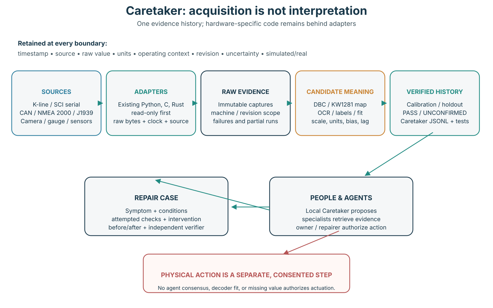
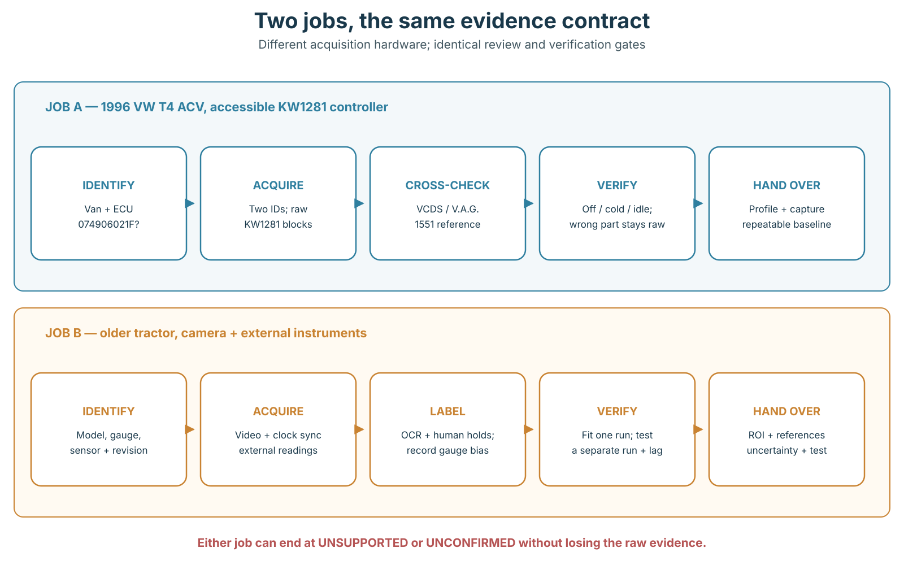
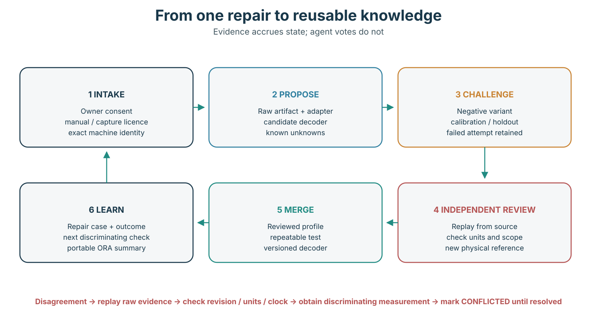
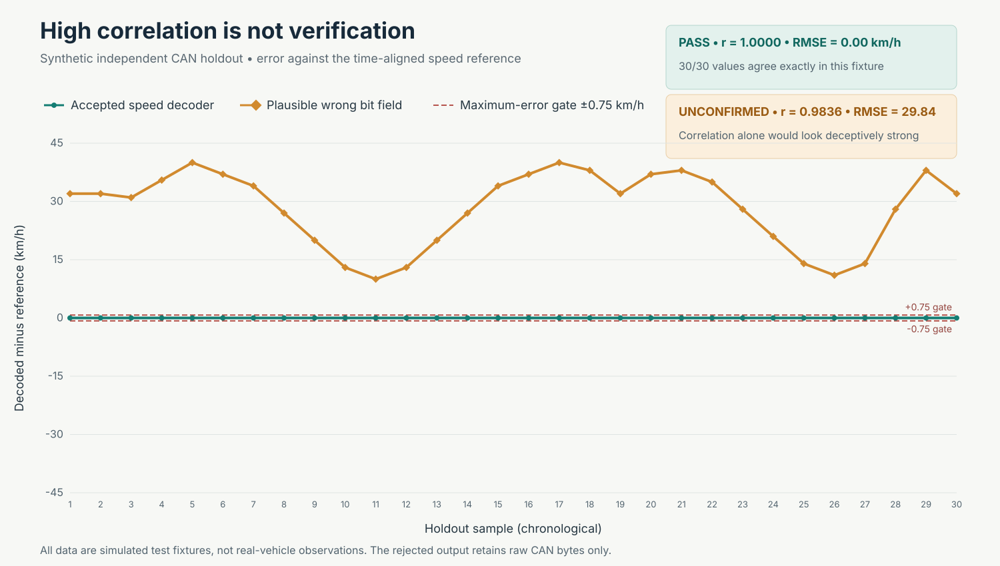

# Caretaker: an evidence-led right-to-repair architecture for old machines

**Research and prototype report — 13 November 2026**

**First target:** 1996 Volkswagen T4 2.5 TDI ACV

**Companion implementation:** [offline Rust replay prototype](../../tools/replay/README.md)

## 1. One-page verdict

**Build Caretaker as the evidence and verification layer, not as another protocol scanner, firmware collection, or autonomous repair agent.** The useful unit of reuse is a revision-scoped, replayable claim: these bytes came from this machine, under these conditions; this decoder was fitted on one capture and checked against an independent reference on another; this person or tool observed the result; and this remaining uncertainty is explicit. Caretaker’s existing adapter document already points in that direction, but labels itself a draft and says that its `value` string is not a validated interchange standard ([Caretaker adapter contract](https://github.com/Hulupeep/caretaker/blob/007650974d550a54d1bcda0b6d0236e4bb66ffda/docs/adapter-contract.md)). The current T4 conversions are likewise deliberately provisional and revision-gated, while the supplied demonstration is synthetic rather than a physical-van validation ([T4 profile](https://github.com/Hulupeep/caretaker/tree/007650974d550a54d1bcda0b6d0236e4bb66ffda/machines/vw-t4-acv), [T4 decoder](https://github.com/Hulupeep/caretaker/blob/007650974d550a54d1bcda0b6d0236e4bb66ffda/tools/t4/acv.py)).

**Reuse working specialists.** Use the existing Python KW1281/T4 code for acquisition; study and call the Jeep XJ project’s Arduino/SCI bridge, protocol documentation, scanner, parameter notes and ROM identity checker; use SocketCAN plus CSS Electronics’ deterministic survey/search/fit/verify scripts for CAN investigation; and call CANboat rather than recreating NMEA 2000 or J1939 decoding. BlueSCSI is the relevant pattern when an obsolete peripheral must be emulated, LinuxCNC/Mesa when a dead controller should be replaced without discarding the machine, and Ghidra when legally obtained firmware must be understood. iFixit, Identifix and the Open Repair Alliance offer three different knowledge-system lessons—guided procedures, technician-confirmed cases, and interoperable repair-outcome data—but their content cannot simply be copied into one open corpus.

| Decision | Recommendation |
|---|---|
| **Caretaker owns** | Machine/component/revision identity; immutable raw-evidence references; source/unit/time/uncertainty provenance; decoder applicability; calibration-versus-holdout gates; local machine history; repair cases; independent replay; disagreement states; anonymised, owner-controlled publication. |
| **Caretaker calls** | Existing T4/KW1281 Python, XJ/SCI tools, SocketCAN, CSS analysis scripts, CANboat, camera/OCR and external-instrument adapters, BlueSCSI, LinuxCNC and Ghidra. Keep their native raw outputs and licences. |
| **Implemented now** | A dependency-free Rust crate that replays a narrow class of classic-CAN CSV captures, applies a fixed unsigned little-endian DBC signal, checks it against an independent reference, emits Caretaker JSONL, and semantically imports the existing T4 JSONL demonstration. Fixtures, negative cases, tests and one demo command are in the [replay prototype](../../tools/replay/README.md). |
| **Actually demonstrated** | Seven Rust tests pass on the clean-applied patch; calibration returns `CALIBRATION_ONLY`; a separate 30-sample synthetic holdout returns `PASS`; a wrong but correlated bit field returns `UNCONFIRMED` and stays raw; six T4 records compare exactly with fresh Python output in an independent checker. No hardware I/O occurred. |
| **First real test** | On a consented 1996 T4 ACV, prove exact ECU identity, safe read-only cable operation, repeatable acquisition, and agreement with an independent scanner on engine-off zero RPM, cold coolant near ambient, and stable idle. Preserve raw triplets and wrong-part/wrong-type negative controls. Do not begin with actuation, fault clearing, adaptation reset or ECU writing. |
| **Collaboration** | Start with one local agent and deterministic tools over Git artifacts. Add bounded specialists when they can return a discriminating check. Add RuFlo-style federation only when independent people and evidence stores genuinely need coordination; never use agent consensus as physical verification. |

The immediate go/no-go criterion is therefore not “can an agent make the van respond?” It is **can another person, on another computer, replay the same evidence and obtain the same bounded conclusion without trusting the builder’s narrative?** The prototype demonstrates that property for synthetic CAN and T4 records. The next milestone is a small physical observation study, not a larger agent swarm.

## 2. Scope, evidence grades and research limits

The audit used pinned checkouts where available: Caretaker at `007650974d550a54d1bcda0b6d0236e4bb66ffda`, XJ Scanner at `9239683e5743b9294f26358366a9c5a744a329d5`, and CSS Electronics’ CAN skills at `d357d6ead47bcee131486088d90f9c8bab475830`. Source code, project documentation, build logs, papers, licensing pages and accessible video descriptions were treated as different kinds of evidence. A repository existing is not evidence that its latest claim ran on hardware; a video showing one start is not evidence of repeatable recovery; and a synthetic fixture is not evidence about a real van. These distinctions are especially important for Caretaker because its purpose is to make a future owner’s work safer and more repeatable, not merely to produce a persuasive demonstration.

The research also has explicit limits. The accessible Gearshift Garage descriptions establish the donor, truck, tools, Ghidra work, repeated read/write experimentation and donor start, but a usable transcript was not obtained; consequently, the requested bench-switch reset behaviour, exact saved-image chain and detailed read-back sequence are **not verified here** ([clone video](https://www.youtube.com/watch?v=hYMICks5nDg), [earlier ECU video](https://www.youtube.com/watch?v=7lPHPLIxBsM)). CSS’s real AI sample pack is offered through a newsletter form, so no gated capture was redistributed or used in the prototype ([CSS sample pack](https://www.csselectronics.com/pages/ai-can-bus-sniffer-data-pack)). No VIN, proprietary firmware, subscription manual or private machine history is included in the deliverables.

| Label | What it means in this report | What it may support |
|---|---|---|
| **Physical / independently verified** | A documented physical result with a reference or independent replay that another person can inspect. | A bounded claim for the exact tested revision and conditions. |
| **Self-reported physical** | A builder or technician reports a physical outcome, but this study did not independently reproduce it. | A promising procedure and a test plan, not a universal fact. |
| **Deterministic software result** | A script reproduces a transformation or check on supplied data. | Replay equality and defined metrics, not physical truth by itself. |
| **Simulated** | Data were generated to exercise an interface or failure mode. | Software behaviour only; never hardware compatibility or diagnostic accuracy. |
| **Unresolved / unsupported / conflicted** | Evidence is insufficient, applicability fails, or sources disagree. | Retention of raw evidence and a next discriminating measurement. |

## 3. Working methods worth transferring

### 3.1 Jeep Cherokee XJ: a complete serial-evidence chain, with a costly wrong scale

The strongest end-to-end serial example is deliberately narrow: one **1994 Jeep Cherokee XJ 4.0 L with PCM 56030117**, not “all old Jeeps.” The project publishes the Arduino Nano bridge and sniffing sketches, connector photographs and wiring, the SCI protocol, Python scanner, parameter table, drive-report tooling and agent instructions. Its documented link uses inverted serial at **7812.5 baud**, with two data wires and byte echo behaviour; the repository is GPLv3 and credits inherited ChryslerScanner material under the same licence ([XJ README](https://github.com/MZULALI/xj-scanner/blob/9239683e5743b9294f26358366a9c5a744a329d5/README.md), [Arduino bridge](https://github.com/MZULALI/xj-scanner/blob/9239683e5743b9294f26358366a9c5a744a329d5/arduino/xj_bridge/xj_bridge.ino), [protocol](https://github.com/MZULALI/xj-scanner/blob/9239683e5743b9294f26358366a9c5a744a329d5/docs/protocol.md)). This is directly reusable as a Caretaker adapter boundary: the hardware sketch obtains bytes, the protocol layer frames requests and responses, the parameter layer proposes meanings, and the playbook insists that another vehicle be measured before connection.

Its fuel-trim error is the key transfer lesson. An inherited formula interpreted raw value **110 as approximately +21.6%**, sending a day of testing toward a fuel-delivery problem that did not exist; disassembly of the SBEC routine established **128 as neutral**, making 110 approximately **−4.7%** on the project’s scale. The same notes say vehicle-speed ID `41` reads about double on the test car. `tools/romcheck.py` can check identifying code and can dump the 32 KB program, but the project explicitly says the manufacturer’s code should remain private ([parameter evidence](https://github.com/MZULALI/xj-scanner/blob/9239683e5743b9294f26358366a9c5a744a329d5/docs/parameters.md), [ROM checker](https://github.com/MZULALI/xj-scanner/blob/9239683e5743b9294f26358366a9c5a744a329d5/tools/romcheck.py)). Caretaker should therefore store raw 110, the inherited candidate, the corrected conversion, the exact PCM selector and the disassembly evidence together; it should not overwrite the old value and pretend the ambiguity never existed.

| Layer | Published artifact | Reuse rule |
|---|---|---|
| Electrical identity | [Connector](https://github.com/MZULALI/xj-scanner/blob/9239683e5743b9294f26358366a9c5a744a329d5/docs/connector.md), [wiring](https://github.com/MZULALI/xj-scanner/blob/9239683e5743b9294f26358366a9c5a744a329d5/docs/wiring.md), [schematic SVG](https://github.com/MZULALI/xj-scanner/blob/9239683e5743b9294f26358366a9c5a744a329d5/docs/img/wiring.svg) | Treat pin numbers and voltages as observations from one car; measure the actual plug. |
| Acquisition | [Nano bridge](https://github.com/MZULALI/xj-scanner/blob/9239683e5743b9294f26358366a9c5a744a329d5/arduino/xj_bridge/xj_bridge.ino), [sniffer](https://github.com/MZULALI/xj-scanner/blob/9239683e5743b9294f26358366a9c5a744a329d5/arduino/xj_sniff/xj_sniff.ino) | Keep byte echo and timing in raw captures; do not hide them behind physical values. |
| Interpretation | [Scanner](https://github.com/MZULALI/xj-scanner/blob/9239683e5743b9294f26358366a9c5a744a329d5/pc/xj_scan.py), [parameters](https://github.com/MZULALI/xj-scanner/blob/9239683e5743b9294f26358366a9c5a744a329d5/docs/parameters.md) | Gate each conversion by PCM identity; retain known scale anomalies. |
| Verification / playbook | [ROM checker](https://github.com/MZULALI/xj-scanner/blob/9239683e5743b9294f26358366a9c5a744a329d5/tools/romcheck.py), [agent guide](https://github.com/MZULALI/xj-scanner/blob/9239683e5743b9294f26358366a9c5a744a329d5/AGENTS.md) | Check identity before reuse; never distribute the dumped manufacturer ROM. |

### 3.2 GM E92 cloning: a donor start is necessary evidence, not a recovery procedure

The accessible clone-video description identifies a used **GM E92** donor, a **2018 GMC Sierra Denali 6.2 L**, Codex on a Mac, an eBay OBD-II bench harness and a DSD TECH SH-C31A USB-CAN adapter. It reports that the donor fired and ran without a check-engine light ([Gearshift Garage clone](https://www.youtube.com/watch?v=hYMICks5nDg)). The earlier video describes a spare E92 and homemade bench, roughly five days of work, Ghidra analysis, repeated reads and writes on the spare, subsequent work on the truck, and a later return to stock calibration ([Gearshift Garage ECU experiment](https://www.youtube.com/watch?v=7lPHPLIxBsM)). Those are meaningful self-reported physical outcomes. They do not, without the underlying images, hashes, logs and test sequence, demonstrate byte-exact cloning, recovery from a bad write, or repeatable operation across power states.

The right Caretaker artifact is consequently a bench **recovery case**, not a celebratory “clone succeeded” flag. Record original and donor hardware part numbers, service IDs, software and calibration identifiers, supply voltage, every tool and adapter, image hashes without publishing restricted firmware, and a transaction log linking each write to a subsequent full read-back. Repeat cold power-up, warm restart, key-cycle, sleep/wake and interrupted-write recovery tests. Specifically instrument the reported bench switch: log its contact state, supply rails and module reset behaviour so that “reset while still powered” becomes a measured power-state claim rather than a visual interpretation. Because the accessible transcript did not establish that behaviour, it remains a proposed discriminating test here.

An independent shop supplies a useful production contrast. N2 Speed’s E92/E82/E80/E78 service requires a compatible hardware part-number family and a readable original, then describes bench reading, writing and post-write verification before return ([N2 Speed cloning workflow](https://n2speed.com/gm-e92-e82-e80-e78-ecm-cloning-service)). That is a service workflow, not an open reproducibility study, but it exposes what the video alone leaves unstated: donor compatibility, source readability and verification after writing are operational prerequisites. Caretaker should require those fields and distinguish **read original → write donor → read donor back → compare → vehicle start → repeated restarts → interrupted-write recovery** as separate milestones.

| Claim | Evidence now | Status / next proof |
|---|---|---|
| Donor can start the truck | Accessible description reports firing, running and no check-engine light ([video](https://www.youtube.com/watch?v=hYMICks5nDg)). | Self-reported physical success; preserve exact truck/donor identity. |
| Bench read/write experimentation occurred | Earlier description names spare E92, Ghidra and repeated reads/writes ([video](https://www.youtube.com/watch?v=7lPHPLIxBsM)). | Self-reported; obtain logs, hashes and full read-back comparisons. |
| Switch resets a still-powered module | Requested behaviour was not verifiable from the accessible description/transcript. | Unresolved; measure rails, reset line and switch state together. |
| Clone is repeatable and recoverable | One donor start does not cover repeated cycling or bad-write recovery. | Unproven; run a controlled bench matrix with restore points. |

### 3.3 CSS Electronics: deterministic search and verification around an agent

CSS’s repository is valuable because the agent is not the decoder of last resort. It orchestrates scripts that survey traffic, correlate candidates, search bit fields, fit calibration, build a DBC and verify the result. The code and workflow are MIT licensed, while the project calls itself an illustration rather than a polished tool ([CSS repository](https://github.com/CSS-Electronics/can-bus-reverse-engineering-skills/tree/d357d6ead47bcee131486088d90f9c8bab475830), [licence](https://github.com/CSS-Electronics/can-bus-reverse-engineering-skills/blob/d357d6ead47bcee131486088d90f9c8bab475830/LICENSE)). Its reference sidecars make a known diagnostic value, dashboard video and human-labelled gauge holds enter the same downstream analysis. Video OCR has a mandatory visual-review step, wider lag windows than a clean machine reference, and an explicit `UNCONFIRMED` outcome when the result should not be promoted ([CSS workflow](https://github.com/CSS-Electronics/can-bus-reverse-engineering-skills/blob/d357d6ead47bcee131486088d90f9c8bab475830/.claude/skills/cansub-reverse-engineering/SKILL.md)).

The central warning is that **correlation finds candidates; absolute agreement helps falsify them**. Multiple IDs may carry the same physical signal, an OBD echo can tie with a cluster value, a stationary or sparse reference can fit meaningless fields, and the dashboard may be biased relative to OBD. CSS’s Opel example reports indicated dashboard speed approximately 7% above OBD speed, so fitting away that systematic difference would make the reference look better while hiding its bias ([CSS workflow](https://github.com/CSS-Electronics/can-bus-reverse-engineering-skills/blob/d357d6ead47bcee131486088d90f9c8bab475830/.claude/skills/cansub-reverse-engineering/SKILL.md)). Caretaker should preserve both the candidate fit and the later verification, including lag, units, source bias and rejected alternatives; it should never let a high correlation alone convert bytes into a named physical observation.

| Stage | Deterministic tool contribution | Agent / human contribution | Failure to retain |
|---|---|---|---|
| Capture and survey | Timestamped raw CSV; ID, payload and bit-activity summaries via [survey.py](https://github.com/CSS-Electronics/can-bus-reverse-engineering-skills/blob/d357d6ead47bcee131486088d90f9c8bab475830/.claude/skills/cansub-reverse-engineering/scripts/survey.py). | Choose safe operating states and useful excitation. | A calm baseline cannot establish semantics; modified or missing captures break replay. |
| Reference creation | Diagnostic decoding; OCR sidecars; timestamp alignment via [reference scripts](https://github.com/CSS-Electronics/can-bus-reverse-engineering-skills/tree/d357d6ead47bcee131486088d90f9c8bab475830/.claude/skills/cansub-reverse-engineering/scripts). | Select gauge region, review OCR against video, or label held positions. | OCR confidence can hide individual misreads; indicated speed is not necessarily true speed. |
| Candidate search | Lag-aware [correlation](https://github.com/CSS-Electronics/can-bus-reverse-engineering-skills/blob/d357d6ead47bcee131486088d90f9c8bab475830/.claude/skills/cansub-reverse-engineering/scripts/correlate.py) and [bit search](https://github.com/CSS-Electronics/can-bus-reverse-engineering-skills/blob/d357d6ead47bcee131486088d90f9c8bab475830/.claude/skills/cansub-reverse-engineering/scripts/bitsearch.py). | Form plausible physical hypotheses and choose follow-up captures. | Ties, anti-correlation, clock lag and sparse references can select the wrong carrier. |
| Fit and DBC | Scale/offset fitting and [DBC generation](https://github.com/CSS-Electronics/can-bus-reverse-engineering-skills/blob/d357d6ead47bcee131486088d90f9c8bab475830/.claude/skills/cansub-reverse-engineering/scripts/build_dbc.py). | Judge whether the unit and physical range are plausible. | Calibration fit is not independent proof; non-round or biased fits need scrutiny. |
| Verification | [verify.py](https://github.com/CSS-Electronics/can-bus-reverse-engineering-skills/blob/d357d6ead47bcee131486088d90f9c8bab475830/.claude/skills/cansub-reverse-engineering/scripts/verify.py) checks agreement, lag and plausibility and can return `UNCONFIRMED`. | Obtain an independent capture and resolve bias or conflict. | Never repair a failed verification by silently changing the reference or forcing a label. |

### 3.4 Evidence table: routes into old hardware

No single route dominates. A documented service port gives the cleanest identity and units when it works; passive capture can recover information without commanding the machine; emulation preserves the original host while replacing an obsolete peripheral; firmware analysis can explain a scale but carries legal and bricking risks; external sensing works when electronics are inaccessible; and subsystem replacement can preserve a useful mechanical machine after its original controller becomes unsupportable. The selection should be made after identifying the exact machine and revision, not from the vehicle or appliance badge alone.

The table treats failure evidence as part of the reusable artifact. “Worked” without a raw capture, exact revision, independent observation or recovery path is weaker than a failed attempt with enough evidence to avoid repeating it. Access terms are equally consequential: open source code, open hardware, community guide text, gated datasets and proprietary repair databases require different treatment in Caretaker.

| Route and exact example | Achievement and verification | Reusable artifacts and access | Failure or misleading result to preserve |
|---|---|---|---|
| **Documented obsolete serial port — 1996 VW T4 2.5 TDI ACV, provisional ECU `074906021F` profile.** The current Python tool targets KW1281 over an FTDI K-line lead and records identity, faults and measurement groups ([T4 build](https://github.com/Hulupeep/caretaker/tree/007650974d550a54d1bcda0b6d0236e4bb66ffda/machines/vw-t4-acv)). | The decoder emits named values only when the ECU part and expected field-type byte match; other part/type combinations remain raw. Existing demonstration evidence is scripted and synthetic, so physical agreement remains to be tested ([T4 conversion code](https://github.com/Hulupeep/caretaker/blob/007650974d550a54d1bcda0b6d0236e4bb66ffda/tools/t4/acv.py)). | [Wiring SVG](https://github.com/Hulupeep/caretaker/blob/007650974d550a54d1bcda0b6d0236e4bb66ffda/machines/vw-t4-acv/wiring.svg), [source list](https://github.com/Hulupeep/caretaker/blob/007650974d550a54d1bcda0b6d0236e4bb66ffda/machines/vw-t4-acv/sources.md), Python logger and decoder. Caretaker code is MIT; linked manuals retain their own terms ([Caretaker licence](https://github.com/Hulupeep/caretaker/blob/007650974d550a54d1bcda0b6d0236e4bb66ffda/LICENSE)). | First-registration year, engine badge or wire colour is not enough to select a profile. Unknown part/type bytes must remain raw; synthetic demo readings must not become a claim about the van. |
| **Obsolete SCI service interface — 1994 Jeep Cherokee XJ 4.0 L, PCM `56030117`.** Arduino Nano bridge plus Python scanner and drive reports ([XJ Scanner](https://github.com/MZULALI/xj-scanner/tree/9239683e5743b9294f26358366a9c5a744a329d5)). | Raw readings originate at the vehicle’s SCI PCM through the bridge. Parameter meanings inherit from ChryslerScanner, with the fuel-trim correction checked against disassembled SBEC code and a ROM identity tool ([parameter notes](https://github.com/MZULALI/xj-scanner/blob/9239683e5743b9294f26358366a9c5a744a329d5/docs/parameters.md)). | [Bridge sketch](https://github.com/MZULALI/xj-scanner/blob/9239683e5743b9294f26358366a9c5a744a329d5/arduino/xj_bridge/xj_bridge.ino), [protocol](https://github.com/MZULALI/xj-scanner/blob/9239683e5743b9294f26358366a9c5a744a329d5/docs/protocol.md), [scanner](https://github.com/MZULALI/xj-scanner/blob/9239683e5743b9294f26358366a9c5a744a329d5/pc/xj_scan.py), [ROM checker](https://github.com/MZULALI/xj-scanner/blob/9239683e5743b9294f26358366a9c5a744a329d5/tools/romcheck.py); GPLv3 ([licence](https://github.com/MZULALI/xj-scanner/blob/9239683e5743b9294f26358366a9c5a744a329d5/LICENSE)). | Raw fuel trim 110 inherited as about +21.6% was actually about −4.7% on the corrected scale and misdirected a day of testing; speed ID `41` reads about double on the test car. A scale needs evidence, not inheritance alone. |
| **Passive undocumented CAN — CSS workflow, including an Opel Astra speed investigation.** Raw CAN is aligned with OBD, video OCR or labelled holds to propose and verify a DBC ([CSS workflow](https://github.com/CSS-Electronics/can-bus-reverse-engineering-skills/blob/d357d6ead47bcee131486088d90f9c8bab475830/.claude/skills/cansub-reverse-engineering/SKILL.md)). | Survey, correlation, bit search, fitting, DBC construction and verification are inspectable Python steps. Verification considers lag and absolute agreement and may return `UNCONFIRMED`; video OCR requires human review. | [Scripts](https://github.com/CSS-Electronics/can-bus-reverse-engineering-skills/tree/d357d6ead47bcee131486088d90f9c8bab475830/.claude/skills/cansub-reverse-engineering/scripts) and workflow; MIT. Real starter data are newsletter-gated and were not redistributed here ([sample pack](https://www.csselectronics.com/pages/ai-can-bus-sniffer-data-pack)). | Dashboard speed about 7% above OBD demonstrates reference bias; tied carriers and sparse holds can create plausible but wrong correlations. Verification must be absolute and independent, not merely a high `r`. |
| **Bench board/firmware work — GM E92 donor for a 2018 GMC Sierra Denali 6.2 L.** Spare ECU, bench harness, USB-CAN, Ghidra and repeated read/write experiments culminated in a reported donor start ([clone description](https://www.youtube.com/watch?v=hYMICks5nDg)). | A donor start and no check-engine light support one operational outcome. They do not independently verify image equality, repeated power cycling or recovery. N2 Speed separately specifies compatible hardware family, readable original and post-write verification ([shop workflow](https://n2speed.com/gm-e92-e82-e80-e78-ecm-cloning-service)). | Public videos and shop procedure are references, not open firmware. Keep privately obtained images private; publish hashes, tool logs, compatibility selectors and verification results rather than proprietary contents. | Detailed read-back and the reported powered-reset switch behaviour remain unverified in this study. Repeated writes and later stock restoration show why recovery evidence matters ([earlier description](https://www.youtube.com/watch?v=7lPHPLIxBsM)). |
| **Passive marine decode/replay — CANboat for NMEA 2000, with J1939-related tooling.** C and Rust implementations decode captures and live gateways, convert formats, serve JSON streams and pace replay ([CANboat](https://github.com/canboat/canboat)). | Its reverse-engineered PGN definitions and multiple implementations are reusable infrastructure; Caretaker can test a profile by replaying a capture through a pinned CANboat release and comparing emitted observations. | [Definitions documentation](https://github.com/canboat/canboat/blob/master/doc/definitions.md), [file formats](https://github.com/canboat/canboat/blob/master/doc/file-formats.md), [program documentation](https://github.com/canboat/canboat/blob/master/doc/programs.md); Apache-2.0 ([licence](https://github.com/canboat/canboat/blob/master/LICENSE)). | The official NMEA 2000 database is access-restricted, which is why CANboat reverse engineered definitions from observation and public sources. Do not confuse broad PGN coverage with proof for an undocumented vendor-specific frame ([CANboat rationale](https://github.com/canboat/canboat)). |
| **Internal appliance bus — Siemens WM14S750, EPW66018 power module and EPW66027 UI.** The project documents D-Bus-2 wiring, UART framing, CRC16-XMODEM, boot traffic and model-specific interpretations ([BSH research](https://github.com/hn/bsh-home-appliances)). | Frame structure and checksum provide deterministic validation; semantic mappings remain revision/model scoped. A separate ESP32 adapter uses runtime JSON profiles and has no transmit path, making it a strong read-only adapter pattern ([bsh-dbus-adapter](https://github.com/bruestel/bsh-dbus-adapter)). | Board photographs, example logs, browser analyzer and appliance configurations in [BSH repository](https://github.com/hn/bsh-home-appliances); adapter firmware is GPLv3 ([adapter licence](https://github.com/bruestel/bsh-dbus-adapter/blob/main/LICENSE)). | External model name does not establish the internal EP generation. Remaining-time interpolation must be labelled estimated. Appliance electronics may not be isolated from mains earth; never present a direct computer connection as safe ([safety warning](https://github.com/hn/bsh-home-appliances#warning)). |
| **Peripheral emulation — BlueSCSI v2/Ultra on RP2040/RP2350.** SD-card images emulate SCSI disks and other peripherals so an original host can retain its software and controller ([BlueSCSI](https://github.com/BlueSCSI/BlueSCSI-v2)). | Verification belongs at the host: enumerate the emulated device, read a known image, exercise the target operating system, and test power/cabling variations. This differs fundamentally from decoding a sensor value. | Firmware, hardware designs and documentation in [BlueSCSI v2](https://github.com/BlueSCSI/BlueSCSI-v2); firmware is GPLv3 and current hardware uses CERN OHL-S v2 ([firmware licence](https://github.com/BlueSCSI/BlueSCSI-v2/blob/main/LICENSE), [hardware](https://github.com/BlueSCSI/BlueSCSI-v2/tree/main/hardware)). | Project troubleshooting experience around termination power, early Macintosh compatibility, image suitability, old SD cards and cabling shows that a valid emulator can still fail as a system. Preserve the whole host–image–cable–power configuration ([BlueSCSI wiki](https://github.com/BlueSCSI/BlueSCSI-v2/wiki)). |
| **Multimodal external/context sensing — ISOBlue HD on a CASE IH Axial-Flow 6088 during 2019 wheat harvest.** CAN, GNSS and three video views were collected together for roughly 84 hours ([ISOBlue paper](https://pmc.ncbi.nlm.nih.gov/articles/PMC7600794/)). | The paper reports 69 million CAN frames, 230,000 GPS points and 437 GB of video. Human video labels provide context for CAN/GPS interpretation; source code is Apache-2.0 ([paper](https://pmc.ncbi.nlm.nih.gov/articles/PMC7600794/), [source](https://github.com/ISOBlue/isoblue2/tree/hd)). | Open acquisition hardware/software architecture, synchronisation approach and labelling workflow. Reuse the provenance pattern even when Caretaker uses a smaller local store. | CAN ID 27’s yield/flow interpretation is explicitly heuristic and speculative. Rural connectivity delayed streaming and remote login, and Kafka made post-processing cumbersome; local capture and honest semantic uncertainty are essential ([limitations](https://pmc.ncbi.nlm.nih.gov/articles/PMC7600794/#sec6-sensors-20-06053)). |
| **Dead-subsystem replacement — Avid CNC with ESS/CRP850 replaced by Mesa 7I96S and 7I84 under LinuxCNC.** The builder retained the machine while changing its control stack ([Avid build log](https://forum.avidcnc.com/t/adventures-with-linuxcnc/2519)). | The six-month absence of communication/software problems is self-reported operational evidence, not independent certification. The log supplies concrete wiring/controller choices and observed behaviour for replication. | Build narrative, photographs and configuration discussion in the [forum log](https://forum.avidcnc.com/t/adventures-with-linuxcnc/2519); linked files require individual licence checks. | Mach 4 networking/scripting problems motivated the change. Approximately 0.015-inch homing repeatability could create about 0.030-inch two-sided error; “homes successfully” is not an accuracy verification. |
| **Unfinished industrial retrofit — MAHO MH400E EtherCAT/LinuxCNC conversion.** The thread documents an evolving retrofit rather than a finished success ([MAHO build log](https://forum.linuxcnc.org/ethercat/58770-retrofitting-an-old-industrial-cnc-mill-with-ethercat-components-maho-mh400e)). | Reported 2 µm axis reading is a useful observation but not a completed machine acceptance test. The value is a concrete sequence of hardware, driver and integration decisions that another retrofitter can inspect. | Linked machine, PCB and driver artifacts from the [build log](https://forum.linuxcnc.org/ethercat/58770-retrofitting-an-old-industrial-cnc-mill-with-ethercat-components-maho-mh400e); no blanket licence should be assumed for linked repositories. | The project remained unfinished, and two Mesa boards were destroyed on another build described in the discussion. Caretaker must represent partial and failed states instead of converting a build thread into a guaranteed procedure. |
| **Farmer-controlled fabrication — Farm Hack tool library.** Entries such as The Resident, Grainbrain and Prototype Failure: Reemay Robot combine designs with grower context and build narratives ([Farm Hack tools](https://farmhack.org/tools)). | The library is useful for discovering locally maintained mechanical/electronic solutions and the conditions under which people actually built them. Verification and completeness vary by entry, so each artifact needs its own evidence review. | Tool pages, photographs, plans and discussion in the [tool library](https://farmhack.org/tools). Licensing is not uniform across all entries; check each reusable file rather than assigning one corpus-wide licence. | “Prototype Failure: Reemay Robot” is explicitly a failure record. Keeping that outcome alongside working control-unit documentation prevents survivorship bias and supports a better next test ([Farm Hack](https://farmhack.org/tools)). |

### 3.5 Repair knowledge: retrieval, provenance and rights are separate problems

iFixit demonstrates the value of structured guides, photographs, tools, parts and warnings, but not an unrestricted training corpus. Its community content is CC BY-NC-SA 3.0, requiring attribution, noncommercial use and share-alike treatment; its licensing page also prohibits using the data to train AI without separate permission ([iFixit licensing](https://www.ifixit.com/Info/Licensing)). Its API terms add operational requirements around attribution, author/source links, visible parts and tools, safety-warning retention, caching and commercial rights ([iFixit terms](https://www.ifixit.com/Info/Terms_of_Use)). Caretaker should therefore link to or deliberately import only content whose terms permit the intended use, preserve warnings and provenance, and keep any commercial or model-training question separate from “the page was publicly visible.”

Identifix and the Open Repair Alliance sit at other points in the knowledge spectrum. Identifix describes more than three million technician-submitted/confirmed fixes together with OEM manuals, wiring and procedures under subscription access, making it a model for case retrieval and confirmation rather than material to scrape into an open repository ([Identifix Direct-Hit](https://www.identifix.com/direct-hit/)). ORA publishes attempted-repair rows with outcome and barrier fields under ORDS v0.3 and CC BY-SA 4.0; its October 2026 release lists **416,282 EEE rows and 203,591 non-EEE rows**, with data through July 2026 ([ORA downloads](https://openrepair.org/open-data/downloads/)). The removal of `model` in ORDS v0.2 because of collection-quality problems is directly relevant: a field that seems desirable can still be too unreliable to aggregate ([ORDS history](https://openrepair.org/open-data/open-standard/)).

| Platform | Knowledge unit worth adopting | Verification / provenance lesson | Caretaker reuse boundary |
|---|---|---|---|
| iFixit | Ordered guide, photos, tools, parts and warnings. | Preserve author, source, changes and warnings; do not strip context when excerpting. | Link or import under CC BY-NC-SA and API terms; no assumption of AI-training or commercial rights ([licensing](https://www.ifixit.com/Info/Licensing)). |
| Identifix | Technician case connected to a confirmed fix and OEM reference material. | A useful prior is a retrievable case with provenance, not an unsupported generated diagnosis. | Subscription/proprietary content stays outside the open corpus; store user-authorised references and locally obtained evidence ([Direct-Hit](https://www.identifix.com/direct-hit/)). |
| Open Repair Alliance | One attempted repair with product category, problem, work, outcome and barrier. | Standardised outcomes enable aggregation; poor identity fields may need removal rather than false precision. | ORDS-shaped public repair summaries and CC BY-SA 4.0 data can be reused with attribution/share-alike; private raw machine records remain separate ([standard](https://standard.openrepair.org/standard.html)). |
| Caretaker repair case | Raw evidence + exact revision + candidate interpretation + independent check + physical outcome + repeatable test. | A later owner can replay the claim and see disagreement, uncertainty and failed attempts. | Publish an anonymised case only with owner consent; do not attach proprietary firmware or restricted manual content. |

## 4. Caretaker architecture

### 4.1 Components and ownership boundaries



The architecture has five planes. **Sources** include service ports, passive buses, cameras, external instruments, manuals and human observations. **Adapters** acquire or import those sources without deciding what the values mean. **Raw evidence** stores the original bytes/files, hashes, tool versions, timestamps and operating context. **Candidate interpretation** attaches a revision-scoped decoder or measurement method. **Verified history** contains only observations whose defined checks passed; unresolved candidates still produce raw observations, not invented physical quantities. Repair cases, people and agents sit above that history, while physical action is a separate, owner-consented path.

This separation prevents the most damaging failure modes found in the research. A corrected XJ scale can be evaluated against old raw values without erasing the bad interpretation; a CSS candidate can fail holdout without losing the capture; a camera reading can remain a human-labelled estimate; and a replacement controller can have acceptance tests that do not depend on the original protocol. Rust is a good candidate for the small common replay/evidence core because the patch can be deterministic, testable and dependency-light. It should not displace working C, Python, Arduino, ESP32 or LinuxCNC tools where those already solve acquisition well.

| Artifact | Belongs here | Must not contain | Example |
|---|---|---|---|
| **Machine profile** | Stable machine/category identity, identity evidence, components, revision selectors, known operating contexts, safety notes, profile version and test references. | Private owner identity by default; universal claims based on one machine. | T4 ACV profile selects ECU `074906021F` and expected KW1281 field types. |
| **Reusable adapter** | Byte/measurement acquisition, framing, checksum, clock handling, source metadata and raw export for a protocol or instrument family. | Model-specific meaning or diagnosis hard-coded into acquisition. | KW1281 reader, XJ SCI bridge, SocketCAN CSV importer, CANboat converter, camera sidecar importer. |
| **Decoder / calibration** | Bit geometry, units, scale/offset, valid range, source reference, calibration capture ID, holdout verification and known biases. | A semantic label unsupported by applicability and verification gates. | `VehicleSpeed` at bits 0–15, unsigned little-endian, scale 0.01 km/h, checked on a separate capture. |
| **Revision overlay** | Part/software/calibration/PCB selectors, field substitutions, exceptions and negative fixtures. | Silent fallback to a nearby revision. | Wrong T4 part or field type remains raw; a different appliance EP generation requires a different profile. |
| **Observation history** | Timestamp, anonymised machine ID, kind, value, unit, source, context, simulation flag, evidence and uncertainty details. | Missing data recoded as healthy; diagnosis presented as a sensor reading. | One append-only JSONL sequence receiving T4, CAN and camera observations. |
| **Repair case / repeatable test** | Symptoms, raw evidence references, hypotheses, checks, outcomes, safety preconditions, independent review and reusable procedure. | Proprietary firmware/manual payloads or agent votes substituted for measurements. | “Cold-start intermittency” case links before/after captures and a test the next owner can run. |

### 4.2 One evidence envelope, multiple kinds of truth

Caretaker’s existing eight fields are a useful compatibility base: `timestamp`, `machine`, `kind`, `value`, `unit`, `source`, `context`, and `simulated` ([adapter contract](https://github.com/Hulupeep/caretaker/blob/007650974d550a54d1bcda0b6d0236e4bb66ffda/docs/adapter-contract.md)). The prototype retains them and places additional evidence in `details`, avoiding a premature breaking change to `value`’s current string representation. A production schema should add stable observation and evidence IDs, raw-artifact hashes, adapter/decoder versions, applicability decision, verification status, uncertainty and clock-alignment metadata. Numeric values can later gain typed representations through versioning, but replay should preserve the original record exactly.

Uncertainty is structured rather than a single confidence score. `reference_uncertainty` describes the instrument or human reference; `alignment` records interpolation and lag; `verification` records calibration/holdout outcome; `observation_class` separates simulation, self-reported physical observation and independently checked observation; and `raw` remains available even when interpretation fails. “Unknown” is preferable to a made-up numeric uncertainty. A high decoder confidence cannot compensate for an uncalibrated camera, and agreement between agents cannot change any of these evidence fields.

```json
{
  "timestamp": "2026-11-13T12:00:00Z",
  "machine": "anonymous-local-machine-id",
  "kind": "vehicle_speed",
  "value": "42.5",
  "unit": "km/h",
  "source": "can-dbc-replay",
  "context": "consented road capture; operating-state label",
  "simulated": false,
  "details": {
    "raw_hex": "2A10000000000000",
    "raw_value": 4250,
    "decode": "dbc-candidate",
    "verification": "PASS",
    "decoder_sha256": "…",
    "capture_sha256": "…",
    "reference_source": "independent-diagnostic-tool",
    "reference_alignment": "linear interpolation; lag checked",
    "reference_uncertainty": "not supplied",
    "applicability": "exact component and revision matched"
  }
}
```

### 4.3 Job A: accessible controller — the T4 K-line path



For the T4, acquisition and interpretation already have a useful split. The Python/KW1281 layer owns cable communication, block titles and raw three-byte fields. The profile owns the ECU selector and field mapping. The replay core can import the resulting observations without knowing anything about K-line. A real job starts by establishing identity and consent, then collecting engine-off and controlled running references, and only then evaluating whether the provisional conversions agree. The output is not “the ECU is healthy”; it is a set of timestamped observations and a repeatable acquisition/verification case.

A contributor extending another T4 variant should not edit the global conversion table until it happens to produce plausible numbers. They should submit an identity record, raw capture, independent reference and negative cases for the wrong part/type, then obtain review. If a field differs, a revision overlay or new profile is created. If the machine does not match, the adapter may still return valid raw triplets while the semantic profile returns `UNSUPPORTED`. That is a successful safety outcome because it preserves useful evidence without making a false physical claim.

| Step | Input and actor | Caretaker artifact | Pass / stop condition |
|---|---|---|---|
| 1. Consent and identify | Owner/repairer; van sticker, build month, ECU and cable details. | Private identity record and sharing decision. | Exact ACV/ECU/loom evidence; otherwise stop profile selection. |
| 2. Offline rehearsal | Builder; existing demo and patch. | Test output proving software path before hardware. | All tests pass; synthetic records remain labelled. |
| 3. Electrical/interface check | Repairer; measured socket and cable documentation. | Pin/voltage observation and tool identity. | Measured interface matches plan; no reliance on wire colour. |
| 4. Read-only identity | Existing Python adapter. | Two consistent ECU identification captures with raw blocks. | Repeatable identity; mismatch becomes `UNSUPPORTED`. |
| 5. Reference observations | Repairer plus independent scanner/instrument. | Engine-off RPM, cold coolant/ambient, stable-idle series. | Clock/unit/source preserved; disagreement remains visible. |
| 6. Verify and package | Independent peer replays captures. | Bounded profile verification and reusable test. | Named values only if gates pass; otherwise raw/unresolved. |

### 4.4 Job B: no usable controller interface — older tractor with camera and external instrument

Consider an older tractor whose original controller is absent, undocumented or unsafe to disturb, but whose mechanical gauges and external sensors can be observed. A camera records a gauge while a clamp-on or contact instrument supplies an independent measurement; the owner performs safe, deliberate holds such as stopped, low idle and a higher steady speed. The camera adapter produces frame timestamps, OCR or human-labelled readings, and quality flags. The instrument adapter produces its own timestamped values and units. Neither adapter claims that a CAN-like decoder has been verified; they produce separate observations whose clock agreement and uncertainty are evaluated later.

The history can then answer a bounded question such as “does the indicated tachometer track the external tachometer across these three holds?” A linear fit may describe this machine’s indication error, but it must not be promoted to a universal tractor calibration. If the needle bounces, OCR confuses digits, or clocks cannot be aligned, the result remains unresolved and the video is retained. When the original controller is truly dead, the same evidence can define acceptance tests for a replacement: safe start/stop, speed range, sensor plausibility and repeatability. That is the LinuxCNC lesson translated into Caretaker’s evidence model—replace a subsystem only with explicit acceptance criteria, not because an agent prefers new hardware.

| Step | Evidence produced | Interpretation allowed | Required caution |
|---|---|---|---|
| Fixed camera + time sync | Original video, frame timestamps, gauge region, lighting and camera identity. | Human-reviewed gauge observations with uncertainty. | No invented frames or silently interpolated gauge truth. |
| External instrument | Raw/exported readings, units, instrument ID and calibration information if available. | Independent physical reference within its stated uncertainty. | Appropriate safe attachment by the repairer. |
| Deliberate holds | Operator-labelled stopped/idle/higher-speed intervals and actual times. | Alignment, lag and absolute comparison. | Holds are labels, not proof of an internal digital value. |
| Comparison | Paired observations, alignment method, errors and rejected segments. | Machine-specific indication relationship if gates pass. | Correlation alone is insufficient; preserve reference bias. |
| Reusable test | Script/procedure referencing original video and reference data. | Another owner can repeat the same bounded comparison. | New gauge, camera or revision triggers revalidation. |

### 4.5 From a manual or capture to a reviewed profile



A contribution starts with an intake manifest: machine and component identity, source rights, consent, raw hashes, adapter/tool versions, operating context and known safety limits. A manual can support a documented command or unit; a capture can support an observed pattern; neither alone proves a semantic mapping. The contributor proposes the smallest decoder/profile change and includes both positive and negative fixtures. Automated tests establish deterministic behaviour, while a reviewer checks whether the physical inference follows from the evidence.

Disagreement produces `CONFLICTED`, not a vote. Reviewers replay the same raw artifacts, check machine/revision applicability, units, scale, clocks and reference bias, and request one measurement that would distinguish the surviving hypotheses. Only after independent replay and the required physical observation does the contribution become a reviewed profile. A successful repair then becomes a new regression case: its before/after evidence and exact applicability are stored so that the next agent retrieves a testable procedure rather than an anonymous success story.

| Contribution gate | Required package | Reviewer question |
|---|---|---|
| Identity | Exact model/component/revision and identity evidence. | Could this package accidentally run against a nearby but incompatible machine? |
| Evidence | Raw artifact, hash, source/tool, timestamps, context and consent/sharing state. | Can someone reproduce the observation without trusting the narrative? |
| Candidate | Minimal decoder or procedure, units, range, calibration set and known alternatives. | What plausible wrong match would produce a similar result? |
| Verification | Independent capture/reference, absolute errors, lag/uncertainty and unresolved outcomes. | Was any data used both to fit and to prove the claim? |
| Knowledge | Repair outcome, failed attempts, warnings and repeatable test. | Can the next owner run a safe check, and can they tell when it does not apply? |

## 5. Collaboration without false consensus

### 5.1 Roles, exchanges and authority

Caretaker PR #6 already proposes repair cases, specialist manifests, recommendations, evidence deduplication, applicability matching and a blinded pilot spanning a T4 and an older tractor ([Caretaker PR #6](https://github.com/Hulupeep/caretaker/pull/6)). The right implementation is to make those exchanges evidence bundles with narrow authority. The local Caretaker controls the private machine history and tool invocation. A specialist receives only the owner-approved minimum—ideally an anonymised case and selected raw artifacts—and returns a comparable case plus one discriminating check. An independent peer replays the same evidence without accepting the builder’s conclusion. The owner/repairer alone performs or authorises physical checks and decides what leaves the local record.

The important architectural rule is that **recommendation is not observation**. A specialist’s prior case is evidence about what to test next, not a new sensor reading. An independent verifier can confirm deterministic replay while still saying that the physical reference is weak. An owner can choose not to share a VIN, image or location even when a specialist requests it. The case schema should make those distinctions visible so that privacy and evidentiary independence are preserved rather than washed away by a federated summary.

| Role | Receives | Returns | May not do |
|---|---|---|---|
| **Local Caretaker** | Private identity/history, adapter outputs, approved external cases. | Raw-linked observations, candidate profile, verification request, local repair case. | Send private evidence externally by default; turn missing data into health; authorise actuation by inference. |
| **Callable specialist** | Anonymised applicability query and minimum approved evidence. | Comparable case with provenance, alternative hypotheses, one discriminating test or question. | Claim the same revision without evidence; silently import restricted content; issue physical commands. |
| **Independent peer** | Raw artifacts, decoder/profile, claimed output and test environment. | Replay hash/report, agreement/disagreement, applicability and test gaps. | Use the builder’s conclusion as the reference; resolve conflicts by voting. |
| **Owner** | Privacy choices, risks, cost and proposed checks. | Consent, physical access decision, sharing scope and acceptance of outcome. | Be bypassed by an agent or federation. |
| **Repairer / machine-access peer** | Safe procedure, required tools, identity and stop conditions. | Actual observations, reference readings, photographs/logs where consented, failures and final physical state. | Exceed consent or treat simulated output as a hardware result. |

### 5.2 Resolving disagreement and converting repairs into tests

When two parties disagree, freeze both claims with their evidence references. First replay the raw bytes or measurements independently; if outputs differ, the problem is deterministic tooling or environment. If outputs agree but meanings differ, check exact revision, field type, units, scale/offset, timestamp alignment, lag and reference bias. Then formulate the cheapest safe measurement whose outcome separates the hypotheses. Until that observation exists, mark the interpretation `CONFLICTED` or `UNCONFIRMED` and keep semantic values out of the verified history.

A verified repair becomes reusable through a closure step: record initial symptom and baseline, exact identity, action actually performed by the human, post-repair observations, follow-up interval, remaining uncertainty and negative controls. Extract the smallest repeatable test from that case—for example, “read identity twice, verify engine-off zero RPM, compare cold coolant with ambient, then capture ten idle samples.” The next occurrence retrieves this test as a prior and reruns it; it does not inherit the previous machine’s diagnosis automatically. Failed repairs remain searchable because they eliminate routes and expose misleading indicators.

| Disagreement type | Diagnostic check | Resolution state |
|---|---|---|
| Different output from same raw file | Pin tool versions, hashes and environment; replay independently. | Deterministic defect if outputs differ; otherwise proceed to semantics. |
| Different machine/revision applicability | Compare identity evidence and negative controls. | `UNSUPPORTED` for non-matches; create a revision overlay only with evidence. |
| Different units or scale | Retain raw values; compare known neutral/zero and independent instrument. | Corrected candidate with old interpretation preserved, or `CONFLICTED`. |
| Different time alignment | Check clock source, UTC, interpolation and lag on dynamic events. | Realigned candidate with measured lag, or unresolved if anchors are absent. |
| Different physical interpretation | Obtain a discriminating observation under controlled conditions. | Verified bounded meaning, or `UNCONFIRMED`; never majority vote. |

### 5.3 One agent, callable specialists, or RuFlo federation

A single local agent with tools is the correct starting point because most immediate value comes from disciplined acquisition, replay and packaging rather than coordination. Callable specialists earn their place when they possess genuinely different machine knowledge or tools and can return a concrete prior or falsifying test. RuFlo describes persistent memory, specialist agents, multiple swarm topologies and cross-installation federation, which makes it a candidate coordination layer for independent installations ([RuFlo](https://github.com/ruvnet/ruflo)). It should remain optional infrastructure: it neither supplies missing physical evidence nor makes consensus a verification method.

Federation becomes justified only when separate owners or repairers maintain separate evidence stores and need authenticated exchange of anonymised cases. Even then, each peer must keep its own raw evidence and verification report. Shared memory can help discover a prior, but a shared false scale would replicate the XJ mistake faster. The design should therefore federate **requests, artifacts and independent reports**, not a single mutable belief about the machine.

| Model | Where it earns its place | Strength | Main risk / control |
|---|---|---|---|
| **One agent + deterministic tools** | Local identification, capture import, replay, test generation and case packaging. | Simple, private, auditable, low operational overhead. | Limited domain knowledge; control with explicit unresolved states and external review gates. |
| **Callable bounded specialists** | A known protocol, machine family, firmware method or repair case is needed. | Brings differentiated evidence without continuous swarm complexity. | Hallucinated or inapplicable advice; require manifests, provenance and one discriminating check. |
| **RuFlo federation of peers** | Independent installations/owners need discovery, authenticated exchange and persistent case coordination. | Distribution, specialist routing and durable cross-installation collaboration ([RuFlo capabilities](https://github.com/ruvnet/ruflo)). | Privacy leakage, correlated agent error and false consensus; separate evidence stores, owner approval and independent physical verification. |

## 6. Runnable Rust counterpart

### 6.1 Scope and interface

The companion [offline replay prototype](../../tools/replay/README.md) adds `tools/replay/` and updates the existing tools README. It implements one deliberately narrow capability: **offline replay of recorded evidence into Caretaker observations**. The CAN path reads timestamped CSV frames, a candidate classic-CAN DBC signal and a time-aligned reference CSV. It can fit scale/offset on calibration data, but only a separate holdout can return `PASS`. The T4 path imports existing JSONL records with full JSON parsing and emission, preserving nested details, Unicode, units, context and simulation flags. Both paths end in the same eight-field Caretaker observation envelope plus evidence details.

The crate uses only the Rust standard library and performs **no hardware I/O**. Its CAN decoder intentionally supports only unsigned little-endian `@1+` signals in classic payloads up to eight bytes; other geometry is rejected. Reference timestamps must be UTC `Z` values, units must match, references must be sorted and unique, and interpolation outside the reference interval is rejected. These are prototype boundaries, not claims that a handwritten parser should replace maintained production DBC/CSV/JSON libraries. Existing acquisition tools stay behind adapters and are neither rewritten nor bypassed.

```sh
# Run from the Caretaker repository root:
cargo test --manifest-path tools/replay/Cargo.toml
sh tools/replay/demo.sh

# Optional: choose a demo output directory.
sh tools/replay/demo.sh /tmp/caretaker-replay-demo
```

### 6.2 Tests actually run and observed results

The suite was run with **rustc 1.63.0, Cargo 1.65.0 and Python 3.12.12**. The integrated tree was also checked out separately, after which all seven Rust tests and the complete demo were rerun there. The demo’s independent standard-library Python checker does not call the Rust decoder: it compares the six T4 JSON values directly against freshly generated Python demo records, recalculates all 30 CAN holdout values from raw little-endian bytes, checks units/raw hex/simulation flags, and verifies that the wrong-match output contains no `vehicle_speed` observations.

All included CAN and T4 records are **simulated fixtures**. Calibration and holdout are separate synthetic trajectories; the holdout was not used to fit the candidate. The wrong DBC selects bits 16–31, which actually contain the fixture’s RPM-like field, creating a plausible but incorrect speed interpretation. It fails despite high correlation, illustrating why Caretaker needs absolute error gates and raw containment rather than semantic enthusiasm.

| Check | Actual result | Evidence meaning |
|---|---|---|
| Rust unit/integration suite | **7 passed, 0 failed**. Covers epoch/interpolation, Unicode/escape round trip, little-endian decoding, calibration/holdout, wrong-field containment, T4 semantic equality and rejection of unsupported DBC endianness. | Deterministic software behaviour on supplied fixtures. |
| CAN calibration | `CALIBRATION_ONLY`; 41 samples; fitted scale 0.010000000, offset 0; RMSE 0, maximum absolute error 0, `r = 1`. | Candidate fit is consistent but explicitly not independent verification. |
| Independent CAN holdout | `PASS`; 30 samples; RMSE 0, maximum absolute error 0, `r = 1`; units km/h. | Fixed decoder agrees exactly with this separate synthetic reference. |
| Plausible wrong field | `UNCONFIRMED`; 30 samples; RMSE **29.839152 km/h**, maximum absolute error **40 km/h**, `r = 0.983607`. | Strong correlation still fails absolute gates; all observations remain raw `can_frame_0x123`. |
| Existing T4 input | **6 records preserved**; exact JSON equality with fresh Python output; all remain `simulated = true`. | Two materially different inputs can share the history interface without semantic loss. |
| Independent output checker | `PASS` for T4 equality, 30 independently recalculated CAN decodes and wrong-match raw containment. | Verification is not solely the Rust implementation grading itself. |
| Clean-checkout validation | Seven tests and the full demo passed on a separate clean checkout of the integrated tree. | The deliverable contains the required ignored-by-default synthetic JSONL fixture through a narrow exception. |
| Physical vehicle test | **Not run.** No serial, K-line, CAN interface or ECU was accessed. | No real-machine compatibility, safety or diagnostic claim is made. |



### 6.3 Verification gates and limitations

The prototype requires at least eight aligned samples, RMSE no greater than 0.25 reference units, maximum absolute error no greater than 0.75, correlation at least 0.99, and all decoded values within the candidate DBC range. Calibration additionally compares its fitted scale and offset with the candidate. These numerical thresholds are **demonstration policy**, not universal engineering acceptance criteria. A real profile must choose sample count, uncertainty and error limits appropriate to the quantity, reference instrument and safety consequence; it must also include dynamic and stationary behaviour rather than relying on a convenient synthetic trajectory.

Several important capabilities remain outside the patch. It does not discover signals, parse general DBC geometry, handle CAN FD, infer clock lag, estimate missing uncertainty, deduplicate production histories, authenticate artifacts, or prove a repair. Its linear reference interpolation and small JSON/CSV/DBC implementations exist to keep the demonstration offline and inspectable. Production evolution should add maintained format libraries, signed content manifests, structured evidence identities, profile-specific verification policies and independent real captures while retaining the same adapter boundary and refusal behaviour.

| Current boundary | Behaviour now | Production direction |
|---|---|---|
| DBC geometry | Reject anything except unsigned little-endian `@1+`. | Use a maintained DBC parser; preserve unsupported variants explicitly. |
| CAN frame size | Classic payload up to eight bytes. | Add CAN FD only with fixtures and independent verification. |
| Time | UTC timestamps, sorted reference and bounded linear interpolation. | Estimate clock offset/lag with anchors and retain alignment uncertainty. |
| Verification | Fixed sample/error/correlation/range gates. | Profile-specific acceptance tied to instrument uncertainty and use risk. |
| Evidence identity | Paths and raw values in observation details. | Content hashes, stable IDs, signatures and immutable artifact store. |
| Physical action | None. | Keep separate consented workflows; replay can never authorise actuation. |

## 7. First real-hardware test: 1996 VW T4 ACV

### 7.1 Test objective and preparation

The first hardware test should prove **identity, safe read-only acquisition and measurement agreement**, not attempt a repair. Obtain the owner’s permission for the physical work and for each category of sharing. Record the van’s engine code, build month where available, ECU part/software identification, diagnostic socket and loom condition, cable and host details, and independent reference tool. Keep owner identity, VIN, location and private history local; share only an anonymised evidence package after review. Run the synthetic demo and tests before visiting the machine so that software faults are not debugged through a connected vehicle.

Use a battery-powered laptop and the existing read-only path. Inspect and measure the interface rather than trusting wire colour or first-registration year. Confirm that the selected cable satisfies the logger’s FTDI serial and echo requirements. Obtain two consistent ECU identifications before enabling the provisional ACV mapping, and cross-check identity with VCDS or a V.A.G. 1551 where available. If the part number or expected field-type bytes differ, collect raw evidence only and mark the profile `UNSUPPORTED`; do not select the nearest-looking conversion.

### 7.2 Measurement sequence and acceptance

Capture each channel with its raw triplets and source context. Engine stopped should yield zero RPM; a genuinely cold engine’s coolant reading should be compared with a measured ambient/reference temperature rather than assumed equal; stable idle should produce ten samples with enough timing information to assess repeatability. The independent verifier should replay the raw logs and compare them with the reference-tool observations without changing the profile to improve agreement. A discrepancy is a useful result: retain the raw capture and mark the mapping unresolved until a discriminating measurement explains it.

The acceptance package should contain raw logs, hashes, exact tool versions, identity results, reference readings, units, clock information, negative controls and a concise outcome table. No actuation, output test, fault-memory erase, adaptation reset, firmware read/write or immobiliser operation is needed for this milestone. Physical safety and owner consent take precedence over completing a test matrix; unsafe wiring, uncertain interface identity or unexpected ECU behaviour are stop conditions.

| Order | Observation / action | Record | Acceptance or unresolved condition |
|---|---|---|---|
| 0 | Owner consent and scope | Physical permissions, privacy/sharing choices and prohibited actions. | No work or sharing without explicit consent. |
| 1 | Offline rehearsal | Seven-test result and synthetic demo output. | All pass; all fixtures remain simulated. |
| 2 | Machine and interface identity | ACV evidence, build/loom details, socket, cable, measured pinout/voltage. | Exact match to planned read-only setup; otherwise stop. |
| 3 | ECU identity, twice | Raw identification blocks and independent VCDS/V.A.G. 1551 cross-check. | Two consistent acquisitions; expected `074906021F` before applying provisional mapping. |
| 4 | Engine-off RPM | Raw field triplets plus independent zero-RPM observation. | Decoded zero only if identity/type and conversion gates match; discrepancy stays raw/unresolved. |
| 5 | Cold coolant | Raw coolant field, ambient/reference temperature and actual timestamps. | Agreement within a predeclared tolerance justified by reference uncertainty; no invented tolerance after seeing results. |
| 6 | Stable idle | Ten raw/reference samples with engine context. | Repeatable acquisition and predeclared agreement; report spread rather than only the mean. |
| 7 | Negative variants | Wrong-part and wrong-field-type cases, whether naturally observed or safely constructed offline from captured records. | No provisional physical label on a non-match. |
| 8 | Independent replay | Verifier report, raw hashes and discrepancies. | Another person obtains the same bounded result; conflicts remain visible. |
| 9 | Owner-controlled closure | Private history and optional anonymised repair/test case. | Share only approved artifacts; never include proprietary firmware or restricted manual content. |

### 7.3 What happens after the first pass

A successful first test would justify a real, revision-scoped T4 observation fixture and a more formal adapter contract; it would not validate every field or every ACV van. The next increment should add more independent operating points and a second compatible vehicle before broadening claims. If the test fails, the failure is still valuable when packaged correctly: exact identity, raw triplets, independent reference and disagreement give the next contributor a precise starting point.

Only after observation reliability is established should Caretaker consider repair-specific tests. Any future output tests or writes need their own hazard analysis, owner consent, human control, recovery plan and independent review. Decoder fit, agent agreement, a passing synthetic fixture and missing data are never sufficient authority for physical actuation. This boundary should remain architectural rather than a reminder in documentation.

## 8. Implementation sequence and project decision

### 8.1 Recommended milestones

The patch is intentionally small enough to review and narrow enough to reject unsupported input. The next phase should strengthen evidence identity and real verification rather than expand protocol coverage indiscriminately. A second machine should be added by supplying a profile, capture/reference pair, positive test and plausible negative case; if that requires changing acquisition logic in the Rust core, the adapter boundary is wrong. Meanwhile, Caretaker PR #6’s specialist exchange can be prototyped with static files and manual review before any networked federation is deployed.

The project should also adopt a rights ledger alongside its evidence ledger. Every artifact needs a licence or access classification, attribution requirement, redistribution scope and privacy state. Open code can be called or modified under its licence; open hardware needs its own licence; iFixit’s noncommercial/share-alike terms and API conditions must survive reuse; Identifix remains an authorised reference rather than scraped content; and proprietary firmware stays private even when its hash and test results are shareable. This is part of repeatability because another owner cannot legally or practically run an artifact whose access terms were ignored.

| Milestone | Deliverable | Exit criterion |
|---|---|---|
| **M0 — review and merge replay prototype** | Patch, fixtures, tests, demo and limitations. | Clean application and reproducible results on maintainer hardware. |
| **M1 — evidence manifest v0** | Content hashes, stable observation/evidence IDs, adapter/decoder versions, verification and privacy states. | Existing eight-field records migrate without losing meaning; unresolved records remain raw. |
| **M2 — real T4 observation case** | Consented raw logs, independent scanner comparison, negative variants and verifier report. | Exact revision passes predeclared identity/acquisition/observation gates, or failure is fully packaged. |
| **M3 — second-machine contribution** | CANboat marine capture or camera/instrument tractor case using the same history interface. | New profile/fixtures/tests without hardware-specific logic entering the common replay core. |
| **M4 — repair-case closure** | Before/after observations, human action, follow-up and repeatable test. | Independent peer can run the test and determine applicability and outcome. |
| **M5 — bounded specialist pilot** | Static manifests and anonymised cases from PR #6, with a blinded comparison. | Specialist changes the first discriminating check without receiving unnecessary private data. |
| **M6 — optional federation** | Authenticated independent peers using RuFlo or a smaller equivalent. | Added coordination demonstrably helps separate installations; no consensus-based physical authority. |

### 8.2 Final architectural choice

Caretaker’s differentiator is the chain **identify → acquire raw → propose meaning → challenge → independently verify → preserve a repeatable repair test**. Existing projects already cover many difficult protocol and hardware tasks; rebuilding them would reduce quality and fragment effort. Caretaker should make their outputs composable and reviewable while ensuring that a wrong scale, biased reference, unsupported revision or failed retrofit remains visible as evidence rather than disappearing behind a confident answer.

The decision is therefore to proceed with the replay/evidence core and the first consented T4 observation test, while deferring federation and actuation. The prototype supplies a working software baseline and a meaningful wrong-match demonstration. The hardware study supplies the missing physical evidence. Only the combination can justify calling the resulting T4 profile verified, and even then only for its stated revision, channels and conditions.

## 9. Copy-paste assignment for Seraphina

The following assignment is deliberately divided among a builder, an independent verifier and a peer with physical machine access. No role should mark its own synthetic or self-reported result as independent physical verification. The owner’s consent and sharing decisions override every deliverable schedule.

```text
PROJECT: Caretaker — first evidence-led T4 case and reusable replay test

OBJECTIVE
Turn the current synthetic 1996 VW T4 ACV/KW1281 demonstration into one bounded,
revision-scoped physical observation case. Prove identity, safe read-only acquisition,
and agreement with an independent reference for zero RPM, cold coolant and stable
idle. Leave raw evidence and a repeatable test that another owner can run. Do not
perform actuation, fault clearing, adaptation reset, firmware writing or immobiliser
work.

BASELINE
- Caretaker: https://github.com/Hulupeep/caretaker
- T4 profile: machines/vw-t4-acv
- Existing acquisition: tools/t4/t4_logger.py, tools/t4/kw1281.py
- Provisional conversion: tools/t4/acv.py
- Use the integrated tools/replay implementation on the feature branch.
- Existing adapter fields: timestamp, machine, kind, value, unit, source,
  context, simulated. Preserve additional evidence in details for now.
- All existing demo and supplied CAN/T4 fixture records are synthetic.

NON-NEGOTIABLE SAFETY, PRIVACY AND EVIDENCE RULES
1. Obtain owner permission before physical work and before each sharing decision.
2. Keep VIN, owner identity, precise location and private history local by default.
3. Prefer read-only acquisition. No agent, decoder fit, consensus or missing-data
   state may authorise physical action.
4. Separate simulated, self-reported physical, independently replayed and
   independently observed physical evidence.
5. Preserve raw blocks/triplets, source, units, timestamps, context, tool versions,
   uncertainty and applicability. Never silently overwrite a rejected interpretation.
6. Unknown ECU part or unexpected field-type byte => UNSUPPORTED/raw, not nearest
   profile. Disagreement => CONFLICTED or UNCONFIRMED, not a vote.
7. Do not redistribute proprietary firmware, subscription manuals or restricted
   repair content. Hashes and non-content test results may be shared if permitted.
8. Stop on uncertain pinout/electrical compatibility, unexpected ECU behaviour,
   unsafe machine condition or consent withdrawal.

ROLE A — BUILDER
Deliverables:
A1. A clean branch with the replay implementation and no unrelated reformatting.
A2. A test log containing exact commands, tool versions and results for:
    cargo test --manifest-path tools/replay/Cargo.toml
    sh tools/replay/demo.sh
A3. An evidence-manifest proposal adding stable evidence/observation IDs, raw-artifact
    SHA-256, adapter and decoder versions, applicability, verification status,
    observation class, reference alignment and uncertainty. Preserve compatibility
    with the existing eight fields and value-as-string behaviour.
A4. A T4 acquisition runbook covering consent, identity, socket/cable measurement,
    two ECU identifications, independent VCDS or V.A.G. 1551 cross-check, engine-off
    zero RPM, cold coolant/reference ambient, ten stable-idle samples, and stop
    conditions. Predeclare tolerances before physical values are seen and justify
    them from the reference instrument/profile; do not invent a universal tolerance.
A5. Import/replay tooling for the real T4 raw log without changing hardware-specific
    KW1281 acquisition in the Rust core. Add positive and wrong-part/wrong-type
    negative fixtures. Any real shared fixture must be consented and anonymised.
A6. A pull request containing code, tests, synthetic fixtures, runbook, limitations
    and a clear statement of what remains physically unverified.

Definition of done for the builder:
- Clean patch application and all existing/new software tests pass.
- Demo still yields CALIBRATION_ONLY for calibration, PASS for independent synthetic
  holdout, UNCONFIRMED/raw for the wrong CAN field, and exact T4 JSON preservation.
- No private or proprietary artifact enters Git.
- No physical success is claimed without Role C evidence and Role B review.

ROLE B — INDEPENDENT VERIFIER
Work from raw artifacts and the claimed outputs; do not use the builder’s conclusion
as the measurement reference.

Deliverables:
B1. Clean-environment replay report: commit/patch hash, OS/tool versions, commands,
    raw-artifact hashes, generated-output hashes and pass/fail for every test.
B2. Independent recalculation of CAN holdout values from raw bytes and independent
    comparison of T4 Python/Rust JSON values. Confirm units, timestamps, source,
    context, details and simulated flags survive.
B3. Adversarial checks: wrong CAN bit field, unsupported DBC endianness, short/invalid
    payload, out-of-range reference timestamp, wrong reference unit, wrong T4 ECU
    part and wrong field-type byte. Each must reject or remain raw/unresolved as
    specified; none may acquire a false physical label.
B4. For physical T4 evidence, independently compare raw decoded values with VCDS or
    V.A.G. 1551/reference observations for engine-off RPM, cold coolant and idle.
    Report absolute differences, spread, clock alignment and predeclared gates.
B5. A discrepancy register classifying each issue as deterministic replay, identity/
    revision, units/scale, clock/lag, reference uncertainty or physical interpretation.
    Request one discriminating measurement for each unresolved material conflict.
B6. A signed-off verdict limited to the exact ECU revision, channels and conditions:
    VERIFIED WITHIN STATED LIMITS, UNCONFIRMED, UNSUPPORTED or CONFLICTED.

Definition of done for the verifier:
- Another person can reproduce the deterministic outputs from the supplied package.
- Calibration data were not reused as independent holdout evidence.
- Negative cases stayed unresolved/raw.
- Physical agreement is reported independently, including failures and uncertainty.
- Agent agreement is never counted as a physical observation.

ROLE C — PEER WITH MACHINE ACCESS / OWNER-AUTHORISED REPAIRER
Deliverables:
C1. Documented owner consent for the exact checks and separate consent for sharing.
C2. Private identity sheet: 1996 T4, ACV evidence, build month if available, ECU
    part/software identity, diagnostic socket, loom condition, cable, host and
    independent reference tool. Supply Seraphina only an anonymised approved subset.
C3. Interface verification based on inspection/measurement and the applicable wiring
    information, not wire colour alone. Record any mismatch and stop if uncertain.
C4. Two consistent raw ECU identification captures plus VCDS or V.A.G. 1551 identity
    cross-check where available.
C5. Time-aligned observation set:
    - engine stopped: RPM and independent zero observation;
    - genuinely cold engine: raw coolant and measured ambient/reference temperature;
    - stable idle: ten raw samples and independent reference samples with context.
    Keep raw blocks/triplets and actual timestamps; do not fill gaps.
C6. A physical-outcome log stating exactly what was and was not done, all unexpected
    behaviour, final machine state and follow-up needed. No actuation or clearing.
C7. Owner-approved sharing package with anonymised machine ID and no restricted
    firmware/manual content. If sharing is declined, return only a private local
    result and a shareable synthetic schema/test.

Definition of done for the machine-access peer:
- Consent, exact identity and safe read-only setup are documented.
- Required observations were actually captured or explicitly marked not obtained.
- Raw and independent-reference records are available for Role B.
- The van is left in its original state and the owner decides what is shared.

INTEGRATED ACCEPTANCE PACKAGE
1. Builder PR and runbook.
2. Machine-access peer’s consented raw evidence and physical-outcome log.
3. Independent verifier’s replay and agreement report.
4. One reusable T4 test with exact applicability, stop conditions and negative cases.
5. One anonymised repair/observation case if the owner approves publication.
6. Explicit limitations and next discriminating measurement for every unresolved item.

DO NOT
- Do not call the synthetic fixtures a real-van validation.
- Do not generalise from ECU 074906021F to all T4/ACV vehicles.
- Do not hide a wrong scale by fitting away reference bias after verification.
- Do not clear faults, reset adaptations, write firmware or operate outputs.
- Do not deploy federation to settle a disagreement. Replay raw evidence and obtain
  a discriminating physical measurement instead.
```

## 10. Boundaries and safety notice

This report is a research and software prototype, not evidence that a physical T4, ECU clone, appliance interface, boat network, CNC retrofit or agricultural installation is safe or correct. The Rust results concern synthetic fixtures and deterministic replay; the first physical T4 test remains proposed work. Real repair requires owner consent, exact machine/revision identification, suitable instruments, competent human judgement and independent verification appropriate to the risk. Appliance electronics may be connected to mains earth, and vehicle or machinery action can cause injury or damage; no observation replay, decoder fit or agent recommendation authorises physical actuation.

This material is for general informational and engineering-design purposes only and does not constitute professional automotive, electrical, marine, agricultural, machinery, legal or safety advice. Use qualified professionals and applicable procedures for physical work, and comply with artifact licences, access terms, privacy obligations and local law.
