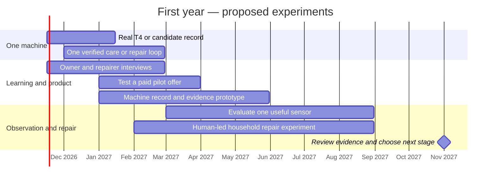
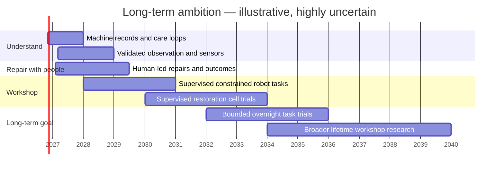

# Caretaker: visual roadmap

**Imagine never having to buy another car.** Imagine a workshop that knows your machines, keeps them working and brings them back to life—while you sleep. This is the journey we want to take together.

This is a starting map for an open-source experiment. The dates are illustrative: we'll redraw them as people contribute, experiments succeed and we learn what it takes to build the workshop.

## First 12 months: establish the care loop

**First gate:** a real observation leads to an understandable action, and an owner or repairer records the actual outcome. If no T4 is available, use an identified candidate or a real household object; do not invent measurements.

**Commercial gate:** put a real case and paid-pilot offer in front of prospective owners or repair specialists. Before substantial product investment, seek a concrete commitment or payment. No paid signal means park the commercial build or continue as a personal experiment.

## Long view: from caretaker to workshop

The long view is an invitation to experiment, not a fixed delivery schedule. Different people can explore different pieces in parallel; the evidence from each experiment helps shape what comes next.

| Transition | Evidence needed before advancing |
| --- | --- |
| Advice to observation | Repeatable, contextualised measurements; comparisons against known results; false alarms and missed detections recorded. |
| Observation to repair | A bounded repair plan, competent human involvement, a documented independent check and a recorded outcome. |
| Human repair to robot task | Appropriate fixtures and safeguards, supervised repeatability, failure recovery, emergency stops and independent review of the actual workspace and task. |
| Supervised to overnight | Task-specific evidence, guarded access, loss-of-power and fault handling, fire and environmental controls, and independent safety review. A remote camera alone is insufficient. |
| One object to many | Evidence for each new object, procedure, tool and hazard; qualified specialists and inspection where needed. |

## What a successful morning could look like

> “The bicycle was inspected, cleaned and the approved part fitted. Here are the before-and-after images and test results. The brakes still need a qualified check before use. I stopped work on the mixer because the part didn't match.”

That's the kind of morning we're working towards. Each experiment, repaired object and contribution brings the workshop a little closer.

[Read the detailed roadmap](roadmap.md) · [Explore the first T4 experiment](../experiments/001-t4-caretaker.md)
