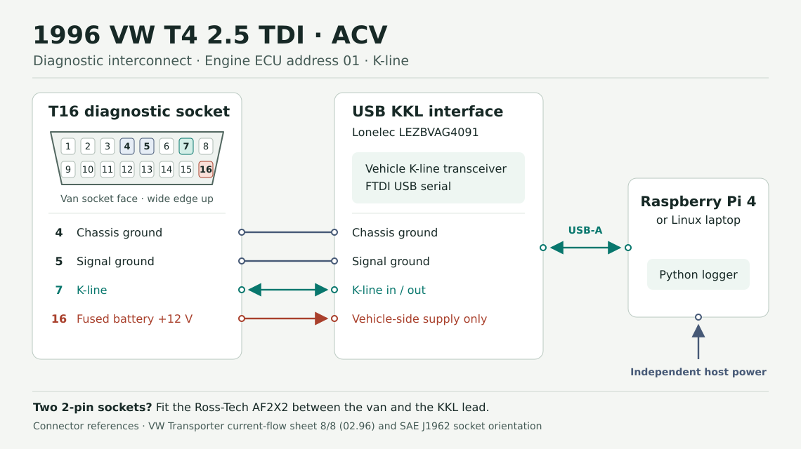

# Connect Caretaker to a 1996 VW T4 2.5 TDI

Start with the **75 kW / 102 PS ACV**, an FTDI K-line cable and a Linux laptop. The same cable and code run on a Raspberry Pi. The first job is to capture the engine ECU identity, stored faults, RPM and coolant temperature. Then try the other groups the ECU exposes.

[Parts and order links](#parts) · [Wiring schematic](wiring.svg) · [Workshop manuals and sources](sources.md) · [Run the logger](#run-the-logger)

## Check the van

1. Confirm **ACV** on the vehicle data sticker or service records. Record the build month if available. First registration alone is insufficient to select a wiring sheet.
2. Look for the diagnostic socket in the dash, near the instrument cluster or centre controls. The January 1996 wiring book shows a single 16-pin socket. Look at the actual van before ordering any adapter, especially if the build or loom history is unclear.
3. Match the plug you see to the table. If the van is still in Germany, ask the seller for a photo with the diagnostic socket cover open and a separate photo or confirmation of the engine code.

> Könnten Sie mir bitte ein Foto vom geöffneten Diagnosestecker und den Motorkennbuchstaben schicken? Ich suche den 2,5 TDI mit 75 kW (ACV).

| Socket fitted | Connection |
| --- | --- |
| One 16-pin trapezoidal socket | Plug the KKL lead directly into the dash socket. |
| Two original VW 2-pin sockets, normally black and white | Confirm the original VW diagnostic connectors and add the Ross-Tech `AF2X2` between them and the same KKL lead. |
| Socket missing or wiring modified | Use the build-specific VW current-flow sheet to identify the loom first. |

## Parts

| Qty | Part | When to buy |
| --- | --- | --- |
| 1 | [Lonelec `LEZBVAG4091`](https://www.lonelec.com/product/vag-com-vcds-compatible-diagnostic-kkl-interface/) USB FTDI KKL diagnostic lead, with 16-pin male plug and USB-A | The only new part for a stock 16-pin van and a Linux laptop with USB-A. Listed at **£19.98 before tax and delivery** on 13 November 2026. [EU delivery terms](https://www.lonelec.com/prices-delivery/) |
| 1 | Existing Linux laptop running on its battery | Use this for the first test. |
| 1 | [Ross-Tech `AF2X2`](https://store.ross-tech.com/shop/af2x2/) VW 2×2 adapter | Buy only if the van has the pair of 2-pin sockets. |
| 1 | [StarTech `USB31CAADP`](https://www.startech.com/en-ie/cables/usb31caadp) USB-C plug to USB-A socket | Buy only if your host has USB-C and lacks USB-A. |

[CCY `200214`](https://ccy.pl/en/shop/zestaw-interfejs-obd2-vag-kkl-409-1-usb-ccy-p%C5%82yta-detail.html) is an EU-sourced alternative. The manufacturer specifies an FTDI FT230XS and an ISO K-line controller. Use one cable. Both are candidates for this logger's FTDI serial and echo requirements, which are still to be checked on the van.

For a dedicated Raspberry Pi, add the following. The Pi uses its normal USB-A port for the KKL lead and its USB-C port for its own power.

| Qty | Part | Use |
| --- | --- | --- |
| 1 | [Raspberry Pi 4 Model B, 2 GB `SC0193`](https://sgeducation.ie/collections/raspberry-pi-4/products/raspberry-pi-4-model-b-2gb) | Linux host. Install [Raspberry Pi OS Lite (64-bit)](https://www.raspberrypi.com/software/operating-systems/) and use a terminal or SSH. |
| 1 | [SanDisk High Endurance 32 GB `SDSQQNR-032G-GN6IA`](https://www.sandisk.com/en-ie/products/memory-cards/microsd-cards/sandisk-high-endurance-uhs-i-microsd) | microSD for the OS and logs. |
| 1 | [Official Raspberry Pi 4 Case `SC0229`](https://www.tme.eu/ie/en/details/sc0229/raspberry-pi-acessories/raspberry-pi/rpi-official-case-for-pi4-red-white/) | Enclosure for the Pi. |
| 1 | [Raspberry Pi `SC0212`](https://cpcireland.farnell.com/raspberry-pi/sc0212/psu-5-1v-3a-usb-c-uk-white/dp/SC15228) 5.1 V / 3 A Type G PSU | Bench power. |
| 1 | [Anker `A1259` Nano 10K power bank](https://www.anker.com/eu-en/products/a1259-built-in-cable-power-bank-10000mah) | Portable power if testing with the Pi, using its built-in USB-C lead at 5 V / 3 A with no other loads. Check that the Pi stays powered during the test. |

[Download the parts list as CSV](bill-of-materials.csv).

## Wiring



| Pin | Signal on the 16-pin van socket | Where it goes |
| --- | --- | --- |
| 4 | Chassis ground | KKL interface ground connection |
| 5 | Signal ground | KKL interface ground connection |
| 7 | Bidirectional K-line | KKL interface vehicle-side transceiver |
| 16 | Fused permanent battery supply | KKL interface vehicle-side supply only |

The diagram is the **front of the vehicle socket**, with the wide edge up. The KKL lead handles the electrical interface, including the K-line voltage levels. It plugs in as supplied. Avoid a bare USB UART, Raspberry Pi GPIO, or an Arduino pin on the diagnostic line. The laptop or Pi has its own power source, and the interface may share ground with the van through USB. Keep this as a temporary setup and unplug the KKL lead when you finish. The 2×2 lead adapts the connector shape. This software requires a controller that wakes over K-line alone.

## Run the logger

Run these commands from the root of a [Caretaker checkout](https://github.com/Hulupeep/caretaker) that includes this guide. Try a synthetic capture first. This step uses only Python 3.10 or newer.

```sh
python3 tools/t4/t4_logger.py demo --output t4-demo.jsonl
python3 tools/caretaker.py show --file t4-demo.jsonl --machine t4-demo
```

For the vehicle, install pySerial. On Debian, Ubuntu or Raspberry Pi OS, install `python3-venv` if the `venv` command fails. Plug the lead into USB first and check the device name.

```sh
python3 -m venv .venv-t4
.venv-t4/bin/python -m pip install -r tools/t4/requirements.txt
.venv-t4/bin/python tools/t4/t4_logger.py ports
ls -l /dev/serial/by-id/
```

The FTDI USB vendor ID is `0403`. Use the device your cable actually reports. A `/dev/serial/by-id/` path is useful if there is more than one USB serial device. If Linux denies access, check the device's group with `ls -l`. On Debian-based systems it is usually `dialout`. Add your account to that group with `sudo usermod -aG dialout "$USER"`, then sign out and back in.

Set `T4_PORT` to your device. With the vehicle end unplugged, check the FTDI receive latency. If Linux exposes `latency_timer` and it is above 2 ms, set it to 2 ms. It can reset when you unplug the USB end.

```sh
T4_PORT=/dev/ttyUSB0
T4_LATENCY="/sys/bus/usb-serial/devices/$(basename "$(readlink -f "$T4_PORT")")/latency_timer"
cat "$T4_LATENCY"
# If the value is above 2:
printf '2\n' | sudo tee "$T4_LATENCY"
```

Park the van and plug in the cable with the ignition off. Turn the ignition on, leaving the engine stopped. Run the following commands one at a time, substituting your own device path if needed. Use one diagnostic application at a time.

```sh
.venv-t4/bin/python tools/t4/t4_logger.py identify --port "$T4_PORT" --baud 9600
.venv-t4/bin/python tools/t4/t4_logger.py faults --port "$T4_PORT" --baud 9600 \
  --context 'ignition on, engine stopped' --output t4-ecu.jsonl
.venv-t4/bin/python tools/t4/t4_logger.py log --port "$T4_PORT" --baud 9600 \
  --group 1 --count 1 --context 'ignition on, engine stopped' --output t4-ecu.jsonl
```

If the ECU responds, use the same `log` command parked at idle outdoors, with `--count 10 --context 'parked idle'`. Start the engine before starting that capture. Each capture reads one group repeatedly. Try `--group 7` for temperatures, `--group 12` for ECU supply voltage, or groups `3` and `11` for air mass and charge pressure. A controller may reject individual groups.

```sh
python3 tools/caretaker.py show --file t4-ecu.jsonl --machine t4
```

| Group | Provisional early ACV fields |
| --- | --- |
| `001` | 1 RPM · 2 injection quantity · 3 quantity adjuster feedback voltage · 4 coolant temperature |
| `003` | 1 RPM · 2 requested air mass · 3 actual air mass · 4 EGR duty cycle |
| `007` | 1 fuel temperature · 3 intake air temperature · 4 coolant temperature |
| `011` | 1 RPM · 2 requested absolute charge pressure · 3 actual absolute charge pressure · 4 N75 duty cycle |
| `012` | 3 ECU supply voltage · 4 coolant temperature |

The logger keeps each raw field triplet, and only adds the provisional physical label if the ECU identifies as `074 906 021 F` and the field's type byte matches. Other ECU IDs and unmatched fields yield raw data. Group `012` is voltage at the ECU. To measure the battery itself, use a separate terminal measurement. This data cannot show a drip or report oil pressure in bar. Those are candidates for independent sensors.

The logger transmits the K-line wake-up and read requests. The command set covers engine address `01`, identification, stored fault reads, measuring-block reads and session framing. It appends timestamped JSONL and keeps completed samples if the link drops. `unavailable` is distinct from a confirmed empty fault memory. Demo records are tagged `simulated`. The two example JSONL files are ignored by Git.

To ask Claude Code or Codex about the van, give it the local `t4-ecu.jsonl` file. Try “Show me what the van reported at key-on and at idle. Include each reading's time, unit and source. Point out any raw or unavailable values, and give me one check I can verify with a workshop tool.”

## First physical test

1. Record the build month, engine code, socket type, adapter and ECU part number. Confirm that `identify` gives the same controller ID on two runs.
2. With the same operating conditions, compare group `001` RPM and coolant on Caretaker and a workshop tool such as VCDS or V.A.G. 1551, one tool at a time. Compare values and units to displayed precision under stable conditions. RPM should be zero with the engine stopped. On a cold engine, compare coolant with ambient temperature. Compare stored codes before marking the fault reader verified.
3. Capture ten samples at stable parked idle. Record the group, field, unit, raw bytes, comparison reading and whether they agreed. Share an anonymised log, the ECU part number and the test result with the repo. Remove serial numbers, VINs and personal information from shared records and photos.

Software has been exercised against scripted ECU exchanges and a synthetic example. The exact 1996 ECU, cable timing and provisional field map still need that first physical test.

## If the ECU does not answer

| What you see | What to check |
| --- | --- |
| No device or permission error | Check USB, the FTDI ID, Linux device permissions and whether another program has the port open. |
| Timeout or incorrect sync byte | Confirm ignition, socket and cable. Let the previous session time out before another attempt. Try `identify --baud 10400` after `9600`. Use `4800` only if you have evidence for that rate. If an independent scanner also fails, have the diagnostic power, ground and K-line checked against the matching VW wiring sheet. |
| Sync works, then bytes time out or the echo fails | Stop other serial software and check the FTDI latency setting above. An echo mismatch also means the serial byte sent by the host did not come back as expected. Record the exact error and the cable SKU. |
| ECU identifies but a group is unavailable or raw | Record the exact part number, group and raw bytes. Compare with the workshop tool before changing the field map. |

For code changes, run the tests from the repo root. They require only Python.

```sh
python3 -m unittest discover -s tools/t4/tests -v
```
